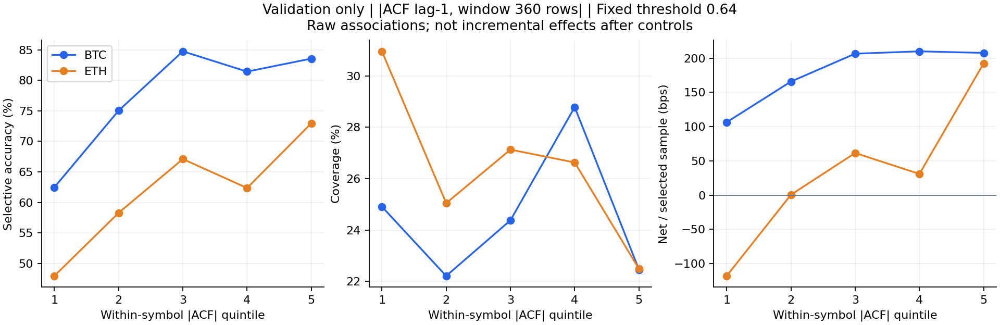
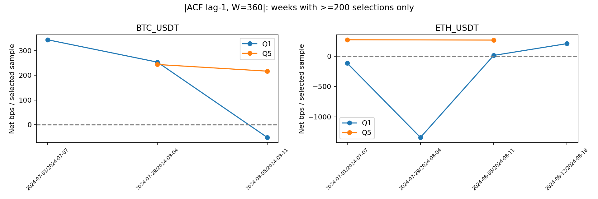

# Autocorrelation / Market Efficiency Exploratory Analysis

Ngày 03/11/2026. **Kết luận: CONDITIONAL GO cho nghiên cứu tiếp; chưa đủ evidence để xây hoặc thay thế baseline bằng adaptive threshold.** Có residual associations nhưng dấu/độ lớn phụ thuộc asset, thời gian và mô hình kiểm soát. Những chênh lệch raw rất lớn không chuyển thành incremental prediction value ổn định. Chưa đề xuất công thức adaptive và chưa benchmark test.

## 1. Dữ liệu, phạm vi và kiểm chứng

Giữ nguyên MLP, labels, calibrated probabilities, hướng dự đoán, fixed τ=0,64 và phí 1 bps. Cùng **80.260 validation samples** (BTC 40.209; ETH 40.051). Fixed chọn 20.463 mẫu: coverage 25,50%, selective accuracy 68,93%, net 99,18 bps/mẫu chọn. Không đọc test predictions; không thay dataset, artifacts cũ hoặc source tác giả.

Feature tính từ **toàn bộ lịch sử mid-price unified theo từng symbol**, sau đó mới ghép validation một-một. Không tính rolling trên cohort đã lọc future return. Mỗi feature tại t chỉ dùng prices tới t, giả định minute aggregate t đã quan sát xong. Window/lag là **số quan sát**, không phải phút lịch chính xác: 360 dòng median khoảng 361 phút. Không resample, forward-fill, winsorize, hoặc clip returns để làm đẹp feature. Lấy log-return từ mid-price hiện có, khác với mid_return clip của volatility feature gốc.

13 cấu hình feature cơ sở và 20 representations: 7 ACF signed, 7 |ACF| từ cùng tính toán, 3 VR, 3 ER. Các cấu hình chốt trước xem `feature_protocol.json`. Hai interaction diagnostics thêm vào mô hình thống kê, không phải feature search rộng hoặc adaptive methods mới. Không chọn window/lag dựa vào test.

**Kiểm chứng:** prefix-invariance PASS cho mọi cấu hình ở hai coin (bỏ phần tương lai không đổi feature quá khứ); direct finite-window ACF/VR trên các cửa sổ giá thật PASS; ER_360 trùng |signed efficiency_360| của bước regime; không missing trên toàn validation. Hash các inputs và source trước/sau phân tích không đổi. Xem `exploration_status.json`, [script](../research_autocorrelation_analysis/explore.py).

Đây vẫn là oracle-filtered cohort |future return|>1%, không có Neutral; label horizon 600 dòng, overlap và các giới hạn cleaning/split/calibration gốc vẫn tồn tại. Causal trailing calculation trên stream đã preprocess không chứng minh raw pipeline hoàn toàn causal. Labels chỉ dùng đánh giá/fit các statistical controls trong validation, không dùng tính ACF/VR/ER.

## 2. Features và công thức

Đặt x_t=log(P_t), r_t=x_t−x_{t−1}, với P_t là mid-price theo từng symbol.

### 2.1. Rolling ACF có dấu và trị tuyệt đối

```math
\bar r_{t,W}=\frac{1}{W}\sum_{j=0}^{W-1}r_{t-j},\qquad
\widehat\rho_{t,W}(k)=
\frac{\sum_{j=0}^{W-k-1}(r_{t-j}-\bar r_{t,W})(r_{t-j-k}-\bar r_{t,W})}
{\sum_{j=0}^{W-1}(r_{t-j}-\bar r_{t,W})^{2}}.
```


Cách đọc: tích các returns cách nhau k dòng, trừ **cùng trung bình của W returns**, chia tổng bình phương returns đã trừ trung bình. Đây là finite-sample ACF dạng không điều chỉnh n−k, không phải Pearson rolling correlation dùng hai mean riêng. Kết quả denominator zero là missing. Cấu hình: k=1,5 với W=60,360,1440; thêm k=15,W=360. Phân tích cả ρ và |ρ|, không xem chúng là hai phép đo độc lập.

ρ>0 mô tả cùng chiều ở lag k, ρ<0 mô tả đảo chiều ở lag đó; |ρ| chỉ cường độ phụ thuộc tuyến tính và bỏ dấu. Mô tả ba band: negative <−0,05; near-zero trong [−0,05;0,05]; positive >0,05. Band 0,05 chỉ để mô tả, **không phải ngưỡng significance**, không đổi theo performance. Dependence ở lag ngắn không tự chứng minh dự đoán được return horizon 600 dòng.

Tham khảo quy ước adjusted=False và các giới hạn inference trong [tài liệu ACF chính thức của statsmodels](https://www.statsmodels.org/v0.13.5/generated/statsmodels.tsa.stattools.acf.html). Phân tích này tự tính theo công thức trên, không cài hoặc chạy statsmodels tests.

### 2.2. Rolling Variance Ratio mô tả

```math
R^{(q)}_s=\sum_{i=0}^{q-1}r_{s-i},\qquad
\widehat{VR}_{t,W}(q)=
\frac{\mathrm{Var}_{ddof=1}\{R_s^{(q)}:s=t-W+q,\ldots,t\}}
{q\mathrm{Var}_{ddof=1}\{r_s:s=t-W+1,\ldots,t\}}.
```


Cách đọc: variance của tất cả W−q+1 overlapping q-return sums nằm **hoàn toàn trong cùng W returns**, chia q lần variance một-step. Cấu hình (W,q)=(360,5),(360,15),(1440,5). VR>1 phù hợp variance tăng nhanh hơn phép cộng variance không tương quan; VR<1 theo chiều ngược lại; VR≈1 gần tỷ lệ random-walk reference. Có finite-sample bias, overlap và heteroskedasticity; không coi lệch 1 là kiểm định bác bỏ random walk hoặc bằng chứng thị trường không hiệu quả.

[arch VarianceRatio documentation](https://arch.readthedocs.io/en/latest/unitroot/generated/arch.unitroot.VarianceRatio.html) phân biệt overlap, debiasing và robust inference. **Không chạy formal Lo–MacKinlay test**, không áp debiasing/robust z-stat của arch ở đây; đây là feature mô tả được định nghĩa riêng. VR và ACF có liên hệ cấu trúc qua variance của tổng returns, nên không coi hai nhóm evidence là độc lập.

### 2.3. Efficiency Ratio của log-price path

```math
ER_{t,W}=\frac{|x_t-x_{t-W}|}{\sum_{j=0}^{W-1}|r_{t-j}|},\qquad W\in\{60,360,1440\}.
```


Cách đọc: độ lớn dịch chuyển ròng chia tổng quãng đường log-price. ER trong [0,1], gần 1 khi đường đi cùng hướng hơn; gần 0 khi nhiều chuyển động bù nhau. **Không phải efficiency theo nghĩa efficient market hypothesis**, không có dấu và không mặc định ER cao thì MLP đáng tin hơn. Đây là log-price ER; không trình bày như một phiên bản dùng absolute dollar-price changes. ER_360 bằng trị tuyệt đối của efficiency feature đã nghiên cứu ở bước regime, không phải một nguồn dữ liệu mới độc lập.

## 3. Distribution, missing và outliers

Bảng minh họa bốn representations chính; missing bằng 0 ở cả 20 representations. `tukey_outlier_share` là tỷ lệ ngoài Q25−1,5IQR/Q75+1,5IQR, không phải tỷ lệ dữ liệu sai. Giữ mọi giá trị. `distributions.csv` có p01/p99 và các window/lag còn lại.

| feature | symbol | missing | minimum | q25 | median | q75 | maximum | tukey_outlier_share |
|---|---|---|---|---|---|---|---|---|
| acf_1_360 | BTC_USDT | 0 | -0.29602 | -0.03759 | 0.00929 | 0.05764 | 0.31469 | 0.01569 |
| acf_1_360 | ETH_USDT | 0 | -0.30969 | -0.04619 | 0.01016 | 0.06074 | 0.36487 | 0.00811 |
| vr_5_360 | BTC_USDT | 0 | 0.46605 | 0.87198 | 0.95538 | 1.05387 | 1.61373 | 0.02201 |
| vr_5_360 | ETH_USDT | 0 | 0.28271 | 0.8767 | 0.96009 | 1.07053 | 1.63449 | 0.01086 |
| er_360 | BTC_USDT | 0 | 0.0 | 0.02199 | 0.04653 | 0.07938 | 0.25605 | 0.0139 |
| er_360 | ETH_USDT | 0 | 0.0 | 0.02276 | 0.04783 | 0.08052 | 0.2926 | 0.0226 |
| abs_acf_1_360 | BTC_USDT | 0 | 0.0 | 0.02234 | 0.04769 | 0.08258 | 0.31469 | 0.02564 |
| abs_acf_1_360 | ETH_USDT | 0 | 0.0 | 0.02598 | 0.05462 | 0.09676 | 0.36487 | 0.01541 |

ACF lag-1,W=360 median gần zero (+0,0093 BTC; +0,0102 ETH), nhưng phân phối có cả hai dấu. VR(5,360) median 0,9554/0,9601; không suy ra mean reversion có lợi nhuận. ER_360 median chỉ 0,0465/0,0478, lý giải tại sao threshold ER>0,20 của bước trước tạo nhóm hiếm.

## 4. Quantiles và fixed-threshold performance trên toàn validation

Q1–Q5 tính riêng từng symbol bằng validation quantiles, chỉ phục vụ mô tả; giữ ties cùng nhóm, không dùng test quantiles. Các cột accuracy/coverage/selective accuracy/ECE là %, confidence_mean là probability. Mẫu số accuracy/ECE là toàn nhóm; selective metrics chỉ trên mẫu confidence≥0,64. Net và expected net là bps; expected net = coverage × net/mẫu chọn. Có đầy đủ counts, confidence min/median/P90/P95/max và mọi cấu hình trong `quantile_metrics.csv`.

| feature | symbol | quantile | n | confidence_mean | accuracy | selected_n | coverage | selective_accuracy | net_selected_bps | expected_net_bps | ece_10 |
|---|---|---|---|---|---|---|---|---|---|---|---|
| acf_1_360 | BTC_USDT | 1 | 8042 | 0.598 | 61.14 | 2591 | 32.22 | 77.0 | 172.157 | 55.466 | 3.0 |
| acf_1_360 | BTC_USDT | 2 | 8042 | 0.581 | 62.37 | 2039 | 25.35 | 76.95 | 168.231 | 42.654 | 4.26 |
| acf_1_360 | BTC_USDT | 3 | 8041 | 0.573 | 60.59 | 1928 | 23.98 | 61.0 | 100.086 | 23.998 | 7.25 |
| acf_1_360 | BTC_USDT | 4 | 8042 | 0.569 | 57.25 | 1631 | 20.28 | 88.72 | 232.363 | 47.126 | 7.74 |
| acf_1_360 | BTC_USDT | 5 | 8042 | 0.578 | 45.44 | 1681 | 20.9 | 86.79 | 246.355 | 51.495 | 19.2 |
| acf_1_360 | ETH_USDT | 1 | 8011 | 0.556 | 68.66 | 1266 | 15.8 | 75.99 | 163.163 | 25.785 | 13.16 |
| acf_1_360 | ETH_USDT | 2 | 8010 | 0.573 | 64.68 | 1894 | 23.65 | 63.36 | 77.176 | 18.249 | 10.94 |
| acf_1_360 | ETH_USDT | 3 | 8010 | 0.577 | 56.62 | 2414 | 30.14 | 48.43 | -126.221 | -38.04 | 10.21 |
| acf_1_360 | ETH_USDT | 4 | 8010 | 0.58 | 51.26 | 2432 | 30.36 | 61.02 | -12.634 | -3.836 | 6.99 |
| acf_1_360 | ETH_USDT | 5 | 8010 | 0.578 | 48.26 | 2587 | 32.3 | 63.59 | 91.643 | 29.598 | 10.57 |
| vr_5_360 | BTC_USDT | 1 | 8042 | 0.578 | 59.94 | 1653 | 20.55 | 69.27 | 127.61 | 26.23 | 4.0 |
| vr_5_360 | BTC_USDT | 2 | 8042 | 0.581 | 54.95 | 2103 | 26.15 | 68.81 | 144.224 | 37.715 | 5.61 |
| vr_5_360 | BTC_USDT | 3 | 8041 | 0.574 | 57.33 | 1996 | 24.82 | 71.99 | 134.476 | 33.381 | 2.03 |
| vr_5_360 | BTC_USDT | 4 | 8042 | 0.582 | 58.75 | 1887 | 23.46 | 88.5 | 206.932 | 48.555 | 6.34 |
| vr_5_360 | BTC_USDT | 5 | 8042 | 0.584 | 55.82 | 2231 | 27.74 | 87.27 | 269.841 | 74.859 | 12.96 |
| vr_5_360 | ETH_USDT | 1 | 8011 | 0.565 | 65.19 | 1657 | 20.68 | 62.34 | -24.166 | -4.999 | 11.07 |
| vr_5_360 | ETH_USDT | 2 | 8010 | 0.563 | 65.41 | 1545 | 19.29 | 64.01 | -35.45 | -6.838 | 10.86 |
| vr_5_360 | ETH_USDT | 3 | 8010 | 0.574 | 55.06 | 2041 | 25.48 | 48.06 | -90.233 | -22.992 | 8.99 |
| vr_5_360 | ETH_USDT | 4 | 8010 | 0.581 | 53.4 | 2556 | 31.91 | 64.28 | 84.695 | 27.026 | 5.9 |
| vr_5_360 | ETH_USDT | 5 | 8010 | 0.582 | 50.44 | 2794 | 34.88 | 64.92 | 113.419 | 39.562 | 9.32 |
| er_360 | BTC_USDT | 1 | 8042 | 0.572 | 53.25 | 1599 | 19.88 | 78.24 | 181.666 | 36.121 | 7.18 |
| er_360 | BTC_USDT | 2 | 8042 | 0.581 | 55.56 | 2064 | 25.67 | 78.25 | 175.889 | 45.142 | 5.77 |
| er_360 | BTC_USDT | 3 | 8041 | 0.58 | 57.46 | 1968 | 24.47 | 81.96 | 219.759 | 53.785 | 5.78 |
| er_360 | BTC_USDT | 4 | 8042 | 0.579 | 58.97 | 1887 | 23.46 | 69.58 | 140.544 | 32.978 | 2.43 |
| er_360 | BTC_USDT | 5 | 8042 | 0.587 | 61.56 | 2352 | 29.25 | 78.83 | 180.247 | 52.716 | 4.14 |
| er_360 | ETH_USDT | 1 | 8011 | 0.569 | 49.78 | 1784 | 22.27 | 54.09 | 8.396 | 1.87 | 7.43 |
| er_360 | ETH_USDT | 2 | 8010 | 0.565 | 56.75 | 1750 | 21.85 | 65.77 | 89.181 | 19.484 | 1.38 |
| er_360 | ETH_USDT | 3 | 8010 | 0.572 | 57.77 | 2108 | 26.32 | 61.05 | 53.479 | 14.074 | 4.1 |
| er_360 | ETH_USDT | 4 | 8010 | 0.576 | 61.35 | 2211 | 27.6 | 60.29 | -3.238 | -0.894 | 7.97 |
| er_360 | ETH_USDT | 5 | 8010 | 0.581 | 63.83 | 2740 | 34.21 | 62.92 | -8.112 | -2.775 | 9.1 |
| abs_acf_1_360 | BTC_USDT | 1 | 8042 | 0.575 | 56.19 | 2003 | 24.91 | 62.46 | 106.426 | 26.507 | 2.51 |
| abs_acf_1_360 | BTC_USDT | 2 | 8042 | 0.573 | 64.39 | 1786 | 22.21 | 75.03 | 165.775 | 36.816 | 7.13 |
| abs_acf_1_360 | BTC_USDT | 3 | 8041 | 0.579 | 63.57 | 1960 | 24.38 | 84.74 | 206.535 | 50.343 | 5.64 |
| abs_acf_1_360 | BTC_USDT | 4 | 8042 | 0.584 | 53.26 | 2315 | 28.79 | 81.43 | 209.954 | 60.438 | 12.4 |
| abs_acf_1_360 | BTC_USDT | 5 | 8042 | 0.588 | 49.38 | 1806 | 22.46 | 83.55 | 207.67 | 46.637 | 13.87 |
| abs_acf_1_360 | ETH_USDT | 1 | 8011 | 0.579 | 56.82 | 2480 | 30.96 | 47.94 | -118.075 | -36.553 | 11.68 |
| abs_acf_1_360 | ETH_USDT | 2 | 8010 | 0.574 | 58.76 | 2006 | 25.04 | 58.28 | 0.482 | 0.121 | 6.65 |
| abs_acf_1_360 | ETH_USDT | 3 | 8010 | 0.574 | 58.16 | 2173 | 27.13 | 67.1 | 61.502 | 16.685 | 2.29 |
| abs_acf_1_360 | ETH_USDT | 4 | 8010 | 0.574 | 55.27 | 2133 | 26.63 | 62.35 | 30.928 | 8.236 | 2.45 |
| abs_acf_1_360 | ETH_USDT | 5 | 8010 | 0.561 | 60.46 | 1801 | 22.48 | 72.96 | 192.47 | 43.276 | 5.25 |

Ví dụ: ETH |ACF_1_360| Q1 net −118,07 bps/mẫu chọn, Q5 +192,47 bps; BTC tương ứng +106,43 và +207,67. Nhưng raw accuracy ETH không tăng đơn điệu, và quan hệ có thể do các episode, direction hoặc volatility. Với signed ACF, BTC Q5 có **accuracy toàn nhóm 45,44%** nhưng selective accuracy 86,79%; selection thay đổi cohort rất mạnh. Không dùng accuracy toàn nhóm thay selective accuracy.



*Hình 1 — Tập trung candidate |ACF lag-1, W=360|, quantiles riêng BTC/ETH trên validation. Q1→Q5 khác cả coverage và thành phần mẫu; đây là raw association, không phải incremental gain sau controls. Nguồn: quantile_metrics.csv đã lưu, feature=abs_acf_1_360.*

### Dấu ACF lag-1,W=360

| symbol | sign_band | n | share | confidence_mean | accuracy | selected_n | coverage | selective_accuracy | net_selected_bps | ece_10 |
|---|---|---|---|---|---|---|---|---|---|---|
| BTC_USDT | near_zero | 20871 | 51.91 | 0.575 | 61.31 | 4890 | 23.43 | 71.74 | 148.767 | 3.83 |
| BTC_USDT | negative | 7831 | 19.48 | 0.598 | 60.82 | 2512 | 32.08 | 77.03 | 172.902 | 3.43 |
| BTC_USDT | positive | 11507 | 28.62 | 0.577 | 47.82 | 2468 | 21.45 | 89.26 | 248.521 | 18.16 |
| ETH_USDT | near_zero | 18659 | 46.59 | 0.577 | 58.58 | 5179 | 27.76 | 55.69 | -40.322 | 8.23 |
| ETH_USDT | negative | 9472 | 23.65 | 0.557 | 68.42 | 1584 | 16.72 | 76.52 | 171.754 | 12.75 |
| ETH_USDT | positive | 11920 | 29.76 | 0.578 | 48.46 | 3830 | 32.13 | 61.72 | 49.912 | 9.36 |

### Predicted Up/Down: Q1 và Q5 signed ACF lag-1,W=360

direction=0 là dự đoán Down, direction=1 là Up. Quantiles vẫn dùng cùng ranh giới theo asset, không chia lại theo direction.

| symbol | quantile | direction | n | selected_n | selective_accuracy | net_selected_bps |
|---|---|---|---|---|---|---|
| BTC_USDT | 1 | 0 | 5764 | 1319 | 81.43 | 185.457 |
| BTC_USDT | 1 | 1 | 2278 | 1272 | 72.41 | 158.365 |
| BTC_USDT | 5 | 0 | 6076 | 574 | 85.71 | 112.15 |
| BTC_USDT | 5 | 1 | 1966 | 1107 | 87.35 | 315.943 |
| ETH_USDT | 1 | 0 | 5944 | 141 | 97.16 | 160.103 |
| ETH_USDT | 1 | 1 | 2067 | 1125 | 73.33 | 163.546 |
| ETH_USDT | 5 | 0 | 4915 | 252 | 33.33 | -30.814 |
| ETH_USDT | 5 | 1 | 3095 | 2335 | 66.85 | 104.859 |

ETH Q1 Down có accuracy 97,16% nhưng chỉ **141 selections**, dưới cờ 200; không coi đó là 141 thử nghiệm độc lập. ETH Q5 Down 33,33%/−30,81 bps, trong khi Up 66,85%/+104,86 bps. Raw dependence theo direction rõ nhưng chưa đủ chứng minh một interaction ổn định.

## 5. Confidence reliability

ECE tính 10 bins cố định đều trên [0,1], weighted absolute difference giữa correctness và top-label confidence; không phải calibration riêng probability Up. Ví dụ signed ACF_1_360 BTC Q5 confidence trung bình 0,5782 nhưng accuracy toàn nhóm 45,44%, ECE 19,20%; ETH Q1 confidence 0,5556, accuracy 68,66%, ECE 13,16%. Confidence không đồng nghĩa cùng reliability ở mọi dependence state.

Calibration gốc đã fit trên validation; các số này không phải independent calibration assessment. Diagram chỉ vẽ bins n≥100; dữ liệu tất cả bins giữ trong `reliability_bins.csv`.

## 6. Incremental information: trước/sau thêm feature

### 6.1. Statistical comparator và temporal protocol

Fit **mô hình thống kê chẩn đoán**, không train lại MLP và không dùng output này để giao dịch. M0 correctness: logistic L2 C=1; M0 return: ridge alpha=10, dự đoán signed sample net bps. Controls: confidence logit; exact symbol×confidence×predicted-direction strata; symbol; predicted direction; confidence×symbol/direction; log volatility_30m và log volatility_15d; tanh(trend_360/2), |tanh(trend)|; Bull/Bear indicators; linear calendar time. Strata ít hơn 20 train rows gộp OTHER; unseen evaluation strata cũng map OTHER. Không dùng validation labels để fit preprocessing của một fold tương lai.

M1 thêm từng representation; thêm hai diagnostics riêng cho ACF_1_360: (i) main + ACF×confidence-logit + ACF×predicted-direction; (ii) main + ACF×ETH. Không stack nhiều features để tìm combination thắng. Numeric scalers và categorical encoder fit **chỉ trên train prefix của fold**; C/alpha không tune. Logistic convergence warnings được coi lỗi; tất cả fits hoàn tất. Parameters/models lưu trong thư mục `statistical_controls/`, không thay classifier MLP gốc.

Chia validation thành bốn khoảng lịch bằng nhau theo ranh giới chung BTC/ETH; ba expanding folds: train quá khứ, evaluate khoảng kế tiếp. Purge train khi future label endpoint vượt eval-start, purge eval khi endpoint vượt eval-end; endpoint phục hồi bằng shift −600 trên unified timestamp, không giả định 600 phút. Không bỏ bớt mẫu vì feature khó hoặc vì return xấu. Common finite cohort vẫn đủ 80.260 mẫu; 62.696 rows thuộc ba evaluation folds sau purge.

| fold | eval_start | eval_end | train_n | eval_n | train_purged | eval_purged | rare_unseen_eval_share | control_columns |
|---|---|---|---|---|---|---|---|---|
| 1 | 2024-07-07 13:29:00+00:00 | 2024-07-21 03:24:00+00:00 | 15723 | 19927 | 761 | 35 | 0.01019 | 23 |
| 2 | 2024-07-21 03:24:00+00:00 | 2024-08-03 17:19:00.000000001+00:00 | 36411 | 19061 | 35 | 1032 | 0.08436 | 26 |
| 3 | 2024-08-03 17:19:00.000000001+00:00 | 2024-08-17 07:14:00.000000001+00:00 | 55507 | 23708 | 1032 | 13 | 0.08685 | 30 |

Đây là forward validation của statistical comparators, **không phải OOS độc lập của MLP**: MLP/calibrator và exploratory selection đã dùng validation. Không đưa test predictions vào bất kỳ fold nào.

### 6.2. Health check: comparator không tổng quát hóa tốt

| fold | n | correctness | baseline_p_mean | baseline_fraction_over95 | baseline_logloss | confidence_reference_logloss | baseline_brier | confidence_reference_brier |
|---|---|---|---|---|---|---|---|---|
| 1 | 19927 | 0.38521 | 0.93938 | 0.80343 | 2.95153 | 0.7115 | 0.60269 | 0.25895 |
| 2 | 19061 | 0.62106 | 0.30586 | 0.0 | 0.92331 | 0.64325 | 0.34108 | 0.22704 |
| 3 | 23708 | 0.5952 | 0.69821 | 0.27843 | 0.98015 | 0.67094 | 0.29065 | 0.23942 |

Fold 1 actual correctness 38,52% nhưng M0 dự báo trung bình 93,94%, log loss 2,9515, tệ hơn confidence reference 0,7115. Hai folds sau M0 cũng tệ hơn reference. Temporal extrapolation, calendar/daily feature confounding và overfit quan hệ prefix là các **khả năng**, chưa ablate để xác định nguyên nhân chính xác. Không sửa hyperparameters hoặc bỏ time control sau khi thấy kết quả để tạo comparator thuận lợi hơn.

**Hệ quả:** gain khi thêm feature chỉ là relative gain so với comparator yếu này; không đủ để chứng minh feature tạo reliability model tốt hoặc trading edge. Confidence reference cũng đã được calibrated bằng toàn validation, nên không coi nó là benchmark calibration độc lập. Dù các models hội tụ số học, statistical validity/generalisability vẫn hạn chế.

### 6.3. Incremental metrics và effect sizes

Gain logloss/Brier/MAE/RMSE = M0 loss − M1 loss, dương là tốt hơn. Summary weighted theo số evaluation rows từng fold; riêng RMSE là **weighted mean của fold-RMSE reductions**, không gọi là pooled global RMSE. `effect_correct_pp`: average thay đổi xác suất correctness dự báo khi candidate từ train Q25 sang Q75, giữ controls khác cố định; `effect_net_bps` tương tự cho ridge. Đây là model-implied conditional contrast, không causal effect. Với interaction, candidate và các tích tương ứng cùng được thay; IQR fit từ train, không từ evaluation. Coefficient/odds ratio có trong CSV; không báo p-value IID.

| feature | positive_logloss_folds | gain_logloss | gain_brier | positive_rmse_folds | gain_rmse_net | gain_mae_net | effect_correct_pp | effect_net_bps |
|---|---|---|---|---|---|---|---|---|
| abs_acf_15_360 | 2 | -0.00014 | 0.00466 | 2 | -2.70928 | -2.17254 | 2.03038 | -2.3648 |
| abs_acf_1_1440 | 2 | 0.00792 | 0.00441 | 3 | 3.30087 | 4.55752 | -1.36415 | 10.1065 |
| abs_acf_1_360 | 2 | 0.0006 | 0.00033 | 3 | 0.51323 | 0.49055 | -0.81336 | -8.34371 |
| abs_acf_1_60 | 1 | 0.00037 | 0.00023 | 3 | 0.07999 | 0.03446 | 0.29501 | 1.85318 |
| abs_acf_5_1440 | 1 | -0.07042 | 0.00679 | 1 | -1.16864 | -1.32545 | -4.4407 | -17.05646 |
| abs_acf_5_360 | 1 | -0.00272 | -0.00097 | 2 | 0.90159 | 1.25383 | 1.17465 | 11.56994 |
| abs_acf_5_60 | 1 | -0.0008 | -1e-05 | 2 | 0.17811 | 0.2579 | -0.5938 | 1.81197 |
| acf_15_360 | 1 | -0.00121 | 3e-05 | 2 | -0.05636 | 0.16853 | 0.08843 | -1.80491 |
| acf_1_1440 | 0 | -0.15447 | -0.01633 | 2 | 4.2022 | 5.54724 | -2.85876 | -56.15187 |
| acf_1_360 | 1 | -0.02955 | 0.0001 | 1 | -6.33996 | -3.13278 | -4.93885 | -36.24615 |
| acf_1_360_asset_interaction | 1 | -0.02206 | 0.00367 | 1 | -4.42554 | -1.08315 | -5.06828 | -38.23548 |
| acf_1_360_interactions | 0 | -0.10158 | -0.0131 | 2 | 8.4537 | 5.20273 | 4.73521 | -6.24064 |
| acf_1_60 | 1 | -0.00232 | 0.00237 | 1 | -3.16425 | -1.91687 | -2.25639 | -7.5774 |
| acf_5_1440 | 2 | 0.08932 | -0.00509 | 2 | 16.41413 | 20.2524 | 5.12971 | 50.03194 |
| acf_5_360 | 2 | 0.03829 | -0.00645 | 1 | 12.45001 | 15.08517 | 5.91312 | 48.50148 |
| acf_5_60 | 1 | -0.0009 | -0.00208 | 1 | 2.24179 | 2.86775 | 3.10366 | 29.57299 |
| er_1440 | 0 | -0.11549 | -0.02267 | 1 | -4.53353 | -2.58026 | 1.55417 | 19.33701 |
| er_360 | 1 | -0.00317 | 0.00047 | 1 | -0.18289 | -0.23988 | -2.46434 | 11.37599 |
| er_60 | 3 | 0.00252 | 0.00032 | 2 | 0.04279 | 0.05281 | -0.58819 | -6.29616 |
| vr_15_360 | 0 | -0.0046 | 0.00096 | 1 | 2.40452 | 3.48302 | 1.37569 | 12.5816 |
| vr_5_1440 | 1 | -0.02419 | -0.02864 | 1 | 5.29275 | 7.15821 | -4.5006 | -85.08615 |
| vr_5_360 | 1 | -0.03165 | 0.00015 | 1 | -4.94293 | -2.84752 | -2.79498 | -18.94078 |

**Điểm đáng kiểm chứng, chưa là winner:** ACF lag-5,W=1440 có weighted Δlogloss +0,08932 và fold-IQR correctness contrast dương cả 3 folds. Nhưng weighted ΔBrier **−0,00509**, fold 2 mất logloss/RMSE, gain trung bình bị fold 1 với comparator rất yếu chi phối. |ACF lag-1,W=1440| có gain nhỏ hơn nhưng Brier và RMSE average dương; tác động đổi dấu giữa folds. ER_60 tăng logloss nhỏ ở cả 3 folds (+0,00252 average), return RMSE gain chỉ +0,043 bps; chưa có ý nghĩa kinh tế rõ.

Các candidates này dưới đây được trình bày để kiểm tra stability chứ không khóa method/window thắng:

| fold | feature | gain_logloss | gain_brier | gain_rmse_net | effect_correct_pp | effect_net_bps |
|---|---|---|---|---|---|---|
| 1 | acf_5_1440 | 0.36654 | 0.01629 | 64.63143 | 2.33417 | 60.46454 |
| 1 | er_60 | 0.0038 | 9e-05 | -0.69318 | 0.08791 | -3.55175 |
| 1 | abs_acf_1_1440 | -0.01198 | -0.00033 | 6.20766 | 0.36847 | 58.5336 |
| 2 | acf_5_1440 | -0.12856 | -0.03796 | -15.91341 | 7.11469 | 47.69062 |
| 2 | er_60 | 0.00104 | 0.00041 | 0.27555 | -0.31848 | -4.09434 |
| 2 | abs_acf_1_1440 | 0.03785 | 0.01418 | 3.48122 | -3.20398 | -9.38787 |
| 3 | acf_5_1440 | 0.0315 | 0.00337 | 1.87764 | 5.8835 | 43.14554 |
| 3 | er_60 | 0.00264 | 0.00044 | 0.47424 | -1.37332 | -10.37314 |
| 3 | abs_acf_1_1440 | 0.00059 | 0.00053 | 0.71265 | -1.34125 | -14.92405 |

ACF_1_360 signed có weighted Δlogloss −0,02955, VR_5_360 −0,03165. Raw group differences không chuyển thành temporal prediction gain ổn định. Dự đoán signed return tốt hơn cũng không đồng nghĩa expected trading utility đã tăng, vì không có selection rule mới được triển khai.

### 6.4. Conditional-strata robustness, thêm ngày

Kiểm tra riêng từng asset bằng cách demean feature và outcomes trong exact confidence×predicted-direction×volatility-quintile×trend-quintile strata, sau đó partial out log micro/daily vol và continuous trend còn dư; thêm day strata cho spec thứ hai. Các quantiles chỉ dùng mô tả toàn validation. Không fit/đổi probabilities MLP. Singleton strata có residual zero, không tạo thông tin giả; số rows trong repeated strata ghi trong CSV. Daily log-vol hằng trong ngày bị bỏ khi không có variation còn lại.

Effect ghi theo thay đổi một **full-validation IQR** của feature, khác train-IQR counterfactual của temporal logistic model. Không so hai effect size như cùng một estimator. Không nhân quả và chưa có confidence interval hiệu chỉnh time dependence.

| feature | symbol | spec | partial_corr_correct | effect_correct_pp_per_IQR | effect_net_bps_per_IQR |
|---|---|---|---|---|---|
| acf_1_360 | BTC_USDT | strata | -0.083 | -5.223 | -18.955 |
| acf_5_1440 | BTC_USDT | strata | 0.185 | 11.885 | 42.31 |
| vr_5_360 | BTC_USDT | strata | -0.051 | -3.036 | -20.041 |
| er_60 | BTC_USDT | strata | -0.003 | -0.173 | 7.488 |
| abs_acf_1_360 | BTC_USDT | strata | -0.156 | -9.456 | -58.505 |
| abs_acf_1_1440 | BTC_USDT | strata | -0.164 | -7.982 | -56.276 |
| acf_1_360 | BTC_USDT | strata_day | 0.036 | 1.649 | 19.59 |
| acf_5_1440 | BTC_USDT | strata_day | 0.044 | 3.283 | 1.041 |
| vr_5_360 | BTC_USDT | strata_day | 0.039 | 1.595 | 8.33 |
| er_60 | BTC_USDT | strata_day | -0.016 | -0.488 | 1.416 |
| abs_acf_1_360 | BTC_USDT | strata_day | -0.02 | -0.846 | -10.103 |
| abs_acf_1_1440 | BTC_USDT | strata_day | 0.006 | 0.257 | -18.487 |
| acf_1_360 | ETH_USDT | strata | -0.154 | -9.822 | -58.876 |
| acf_5_1440 | ETH_USDT | strata | 0.098 | 6.929 | 51.89 |
| vr_5_360 | ETH_USDT | strata | -0.113 | -7.523 | -18.102 |
| er_60 | ETH_USDT | strata | -0.065 | -4.173 | -38.048 |
| abs_acf_1_360 | ETH_USDT | strata | -0.006 | -0.398 | 13.277 |
| abs_acf_1_1440 | ETH_USDT | strata | 0.063 | 5.097 | 56.295 |
| acf_1_360 | ETH_USDT | strata_day | -0.06 | -3.468 | -3.641 |
| acf_5_1440 | ETH_USDT | strata_day | -0.107 | -8.581 | -25.836 |
| vr_5_360 | ETH_USDT | strata_day | -0.052 | -2.92 | 11.853 |
| er_60 | ETH_USDT | strata_day | -0.035 | -1.331 | -11.903 |
| abs_acf_1_360 | ETH_USDT | strata_day | 0.064 | 3.557 | 31.757 |
| abs_acf_1_1440 | ETH_USDT | strata_day | 0.005 | 0.417 | 18.801 |

ACF_5_1440 trước thêm day có conditional correctness +11,89 điểm phần trăm BTC/+6,93 ETH mỗi IQR; sau day thành +3,28 BTC/**−8,58 ETH**. Net conditional sau day chỉ +1,04 bps BTC/−25,84 ETH. |ACF_1_360| sau day −0,85 điểm phần trăm BTC nhưng +3,56 ETH. **Thông tin bổ sung phụ thuộc đặc tả và symbol; chưa có dấu chung đáng tin.**

### 6.5. Interactions

Joint ACF_1_360×confidence/direction diagnostic làm logloss tệ hơn ở **cả ba folds** (weighted gain −0,10158). Model có thể cho IQR correctness effect rất lớn ở predicted Up nhưng forecast loss xấu: đây là ví dụ effect size model-implied lớn không đồng nghĩa generalization tốt. Hệ số raw ACF×confidence đổi dấu từ khoảng −33,18 ở fold 1 sang +13,33/+7,20; scale là log-odds trên tích ACF×logit(confidence), không phải percentage points. Hệ số interaction raw và scalers lưu trong statistical_coefficients.json.

| fold | scope | effect_correct_pp | gain_logloss | gain_rmse_net |
|---|---|---|---|---|
| 1 | predicted_Down | -0.52786 | -0.06056 | 29.77838 |
| 1 | predicted_Up | 66.6954 | -1.22936 | -22.74721 |
| 2 | predicted_Down | -7.31227 | -0.09371 | -2.97008 |
| 2 | predicted_Up | 24.44856 | -0.57548 | -66.56142 |
| 3 | predicted_Down | -8.32382 | -0.01536 | -9.6242 |
| 3 | predicted_Up | 17.12009 | 0.00475 | 7.40255 |

Asset-interaction variant cũng có weighted gain logloss âm (−0,02206). Đây chưa phải evidence rằng interaction không tồn tại; chỉ cho thấy đặc tả nhỏ đã kiểm tra không tạo improvement ổn định ở các periods này. Không thêm nhiều interactions hậu nghiệm để tìm winner.

## 7. Volatility, trend, stability và sensitivity

- Spearman ACF_1_360 với micro volatility chỉ −0,045 BTC/−0,090 ETH; với trend_360 +0,143/+0,173. |ACF_1_360| với micro volatility khoảng −0,004/+0,006, nhưng ETH với daily volatility −0,179. Correlation thấp không chứng minh conditional independence.
- ER_360 với micro volatility +0,311/+0,278, còn signed trend −0,040/−0,075. ER vốn lấy absolute signed efficiency của bước regime, có thể trùng thông tin về trend/noise và volatility; không coi đây là nhóm evidence độc lập.
- ACF_5_1440 với micro volatility −0,078/−0,054 và signed trend khoảng +0,017/+0,011; vẫn có effect đổi dấu sau day controls. Không thể quy nó hoàn toàn cho volatility, cũng chưa chứng minh phụ thuộc thời gian thật là nguyên nhân.
- Window/lag sensitivity lớn: lag-5 1.440 dòng có relative logloss gain tốt hơn lag-1 cùng window, trong khi ACF_1_1440 weighted gain −0,15447. Đây là exploratory multiple comparisons; không chọn method chỉ vì một cấu hình đứng đầu 22 diagnostics.
- Weekly stability không đồng nhất. ETH |ACF_1_360| Q1 có tuần net khoảng −1.337,37 bps/mẫu chọn và tuần +207,13 bps (chỉ tính các tuần ≥200 selections). Signed ACF_1_360 ETH Q5 dao động −407,32 tới +241,36 bps. BTC signed Q1 −125,21 tới +253,91 bps. Mức gain có thể tập trung ở một số episode; không loại tuần xấu.
- |ACF| Q5 ETH chỉ có hai tuần đạt ≥200 selections dù tổng nhóm có 1.801 selections; nhiều row không đồng nghĩa nhiều episode độc lập. Các ô Up/Down hiếm được gắn few_selected/few_samples, không dùng cực trị làm conclusion.
- Sliding windows, labels 600 dòng overlap và autocorrelation của chính feature/outcomes làm số mẫu hiệu dụng nhỏ hơn count. Chưa tính HAC/block-bootstrap CIs; ba folds không đủ để khẳng định significance. Không báo IID p-values. Tất cả values/outliers vẫn giữ nguyên; Tukey flag chỉ mô tả, không sửa data.



*Hình 2 — Net/mẫu chọn của Q1/Q5 tại fixed τ=0,64, chỉ vẽ tuần×nhóm có ≥200 selections. Điểm không xuất hiện là nhóm không đủ count để vẽ, không phải return bằng 0. Chênh lệch tập trung vào một số episodes, nên không suy ra hiệu ứng bền vững từ kết quả gộp. Hình validation đã lưu từ analysis trước.*

## 8. Trả lời câu hỏi và quyết định nghiên cứu

1. **Feature quan hệ mạnh nhất với correctness?** Không có winner ổn định. ACF_5_1440 có association/relative forward-model gain nổi bật nhưng Brier giảm và ETH conditional effect đảo dấu sau day control. |ACF_1_1440| có gain nhỏ hơn, vẫn không ổn định hoàn toàn. Không chọn chỉ dựa raw selective accuracy.
2. **Feature liên hệ expected trading utility?** Raw |ACF_1_360| là giả thuyết đáng chú ý ở ETH: expected net Q1 −36,55 bps/mẫu đủ điều kiện, Q5 +43,28; BTC +26,51/+46,64. Nhưng after-controls sign khác giữa asset và không có temporal expected-utility improvement của strategy mới nào được đo. Ridge ΔRMSE là prediction loss, không phải utility gain.
3. **Thông tin ngoài confidence/volatility/regime/symbol/direction?** Có residual associations trong các controls đã thử, chưa có bằng chứng vững về incremental predictive value có thể tổng quát hóa. Comparator health yếu, effects nhạy day controls, nên không tuyên bố independence hoặc causal dependence effect.
4. **Ổn định thời gian và asset?** Chưa. Folds, tuần, direction và hai coin khác nhau; một số dấu đảo. ER_60 logloss gains nhất quán pooled nhưng nhỏ, không đi kèm return gain rõ và effect sign cũng không cố định.
5. **Signed ACF, |ACF|, VR, ER hay kết hợp?** Giữ signed ACF và |ACF| như hai hypotheses phân biệt; chưa chọn combination. VR không cho relative gain ổn định; ER chủ yếu là kiểm tra trend/noise với incremental effect nhỏ. Kết hợp nhiều nhóm lúc này dễ nhân multiple-testing và thông tin trùng lặp.
6. **Đủ cơ sở xây adaptive threshold?** Chưa đủ để khẳng định nên đổi threshold hoặc có edge. CONDITIONAL GO chỉ cho kiểm chứng tiếp dependence–reliability với independent periods và comparator ổn định; chưa triển khai method hoặc chọn tham số để mang sang test.
7. **Ba hypotheses:** H1: |ACF| liên hệ với reliability/tail-loss theo asset và direction hơn là một quy tắc momentum/mean-reversion chung. H2: long-window lag-5 association phần lớn có thể do calendar episodes; nó sẽ yếu hoặc đảo khi kiểm tra trong ngày/period độc lập. H3: VR/ER raw utility differences chủ yếu phản ánh trend, volatility và oracle-cohort composition, không chắc còn incremental value sau kiểm soát. Chưa thiết kế công thức adaptive để kiểm chứng các hypotheses này.

## 9. Artifacts và tái lập

- `Feature/distribution/quantile metrics`, `direction breakdown`, `weekly`, `correlations`.
- `Temporal incremental metrics`, `summary`, `conditional strata`, `comparator health`.
- validation_features.parquet giữ hàng/cột feature và labels gốc; statistical_validation_predictions.parquet chỉ giữ predictions của **statistical validation comparators**, không thay MLP predictions. Fold models/scalers trong statistical_controls/, protocol/coefficients/status JSON đầy đủ. MLP, dataset, original source và artifacts Volatility/Regime methods cũ giữ nguyên. `Integrity checks` đối chiếu hash classifier gốc, validation predictions và source với metadata lần Regime-B: PASS; không đọc test predictions để làm kiểm tra này.
- Chạy lần lượt `reproduction_setup/venv/Scripts/python.exe research_autocorrelation_analysis/explore.py`, `conditional_analysis.py`, `summarize.py`, `write_report.py` (ba lệnh sau cùng đường dẫn research_autocorrelation_analysis/). Hai script đầu từ chối overwrite output/stats-model directory hiện tại. Để tái lập, đổi OUT sang thư mục mới trong module explore; không xóa kết quả cũ. Không cài thư viện.

Runtime exploration 27.13s, conditional comparators 61.22s; chưa gồm các bước tóm tắt/báo cáo. Peak working set lần lượt 1.064/0.791 GiB.
