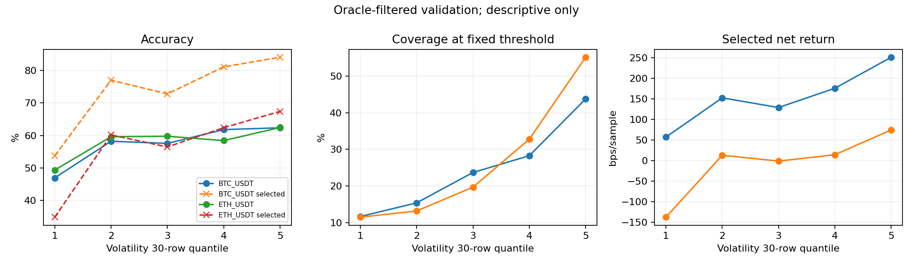

# Phân tích volatility trên validation BTC/ETH

## Phạm vi và cách tính

Chỉ đọc predictions validation của model BTC/ETH hiện tại và các cột cần thiết của unified dataset; không đọc predictions test, không train hay fit adaptive threshold. Ghép `(symbol, timestamp)` một-một: **80.260/80.260** dòng, gồm BTC 40.209 và ETH 40.051; không có dòng thiếu sáu volatility đo bằng standard deviation. BTC: 23/06–15/08/2024 UTC; ETH: 26/06–17/08/2024 UTC. Các khoảng này là khoảng quan sát, không hàm ý liên tục.

Áp dụng đúng threshold đã lưu: `0.6400000000000001`; không dùng cột `execute` trong file prediction vì cột đó thuộc threshold khác. Kiểm tra tái lập baseline validation: **20.463 mẫu**, coverage **25,50%**, selective accuracy **68,93%**, net **99,18 bps/mẫu chọn**. Profit mẫu = return theo hướng dự đoán trừ 1 bps; 100 bps = 1%. Đây là giá trị trên từng mẫu, không phải portfolio PnL.

**Giới hạn quan trọng:** cohort đã lọc theo future return `|return| > 1%`, horizon là 600 **dòng**, không đảm bảo đúng 600 phút. Cùng validation đã dùng cho calibration, model selection và chọn fixed threshold; test cũng từng được xem trong các bước trước. Kết quả dưới đây là khám phá hậu nghiệm trên cohort oracle-filtered, không phải backtest có thể giao dịch hoặc bằng chứng out-of-sample. Các mẫu và future returns chồng lấn nên số mẫu không tương đương số quan sát độc lập.

## Các feature volatility

| Feature | Nguồn và công thức/khung thời gian | Trong 128 feature MLP? |
|---|---|---|
| `volatility_5m`, `15m`, `30m` | Độ lệch chuẩn mẫu (`ddof=1`) của `mid_return = clip(mid_price.pct_change(), -0.12, 0.12)` theo từng symbol; shift 1 dòng rồi rolling 5/15/30 dòng, tối thiểu 2/7/15 dòng. Suffix `m` là tên, khoảng thời gian thực có thể dài hơn khi thiếu dòng. | Không |
| `volatility_5d`, `15d`, `30d` | Độ lệch chuẩn mẫu của daily `Close.pct_change()`, shift 1 daily row rồi rolling 5/15/30 dòng, tối thiểu 2/7/15 dòng. Daily feature của ngày D được join vào micro ngày D+1. | Cả ba có |
| `atr_14` | Daily true range là max của `High-Low`, `|High-prev_close|`, `|Low-prev_close|`; trung bình rolling 14 daily rows, tối thiểu 7, sau đó join sang ngày D+1. Đơn vị giá, không chuẩn hóa theo giá. | Có |
| `volatility_regime` | Cờ `volatility_15d` lớn hơn phân vị 75% theo symbol trên toàn bộ macro history; là indicator, không phải độ lớn volatility. | Không |

Ngoài ra có `spread_bps_std5/std20`, `imbalance_std5/std20`, và `depth_imbalance_{1,5}_std5/std20`: standard deviation của spread/imbalance, không phải volatility của return; shift một dòng, rolling 5 hoặc 20 dòng, không có cột nào trong 128 features. Tính toán và join xem [macro features](../data_preprocessing.py#L1054), [micro features](../data_preprocessing.py#L1690), [rolling statistics](../data_preprocessing.py#L1708), [macro join](../data_preprocessing.py#L1852), [cấu hình](../data_preprocessing.py#L2257); danh sách MLP xem `feature schema` (`../data/btc_eth_1pct/training/feature_schema.json`).

## Volatility 30 dòng: quantile riêng theo symbol

Chọn `volatility_30m` làm ví dụ minh họa, không phải kết luận đó là feature tối ưu. `qcut` theo từng symbol trên validation; không chia các giá trị bằng nhau giữa nhóm. Khoảng phân vị này chỉ để mô tả, không thể dùng trực tiếp như ngưỡng thời gian thực. Bảng gồm accuracy toàn bộ cohort, số mẫu được chọn, coverage, accuracy và net trên mẫu chọn; median/P90 là phân vị confidence của **toàn bộ** nhóm. Bảng CSV có đủ min, median, P90, P95, max và kết quả cho cả sáu volatility features.

| Symbol | Nhóm | N | Accuracy | N chọn | Coverage | Accuracy chọn | Net chọn (bps) | Confidence median / P90 |
|---|---:|---:|---:|---:|---:|---:|---:|---:|
| BTC | Q1 | 8.042 | 46,92% | 936 | 11,64% | 53,74% | 57,26 | 0,5336 / 0,6487 |
| BTC | Q2 | 8.042 | 58,21% | 1.236 | 15,37% | 77,02% | 152,76 | 0,5336 / 0,6487 |
| BTC | Q3 | 8.041 | 57,53% | 1.904 | 23,68% | 72,79% | 129,28 | 0,5336 / 0,7160 |
| BTC | Q4 | 8.042 | 61,79% | 2.273 | 28,26% | 81,13% | 176,18 | 0,5336 / 0,6735 |
| BTC | Q5 | 8.042 | 62,35% | 3.521 | 43,78% | 84,10% | 251,67 | 0,5722 / 0,6735 |
| ETH | Q1 | 8.011 | 49,32% | 917 | 11,45% | 34,79% | -137,67 | 0,5336 / 0,6487 |
| ETH | Q2 | 8.010 | 59,59% | 1.054 | 13,16% | 60,15% | 13,15 | 0,5336 / 0,6487 |
| ETH | Q3 | 8.010 | 59,74% | 1.575 | 19,66% | 56,44% | -1,13 | 0,5336 / 0,6487 |
| ETH | Q4 | 8.010 | 58,40% | 2.626 | 32,78% | 62,38% | 14,44 | 0,5336 / 0,6487 |
| ETH | Q5 | 8.010 | 62,43% | 4.421 | 55,19% | 67,41% | 74,79 | 0,6487 / 0,6735 |

Ví dụ confidence không đồng nghĩa cùng accuracy ở mọi regime: trong plateau calibrated phổ biến nhất, confidence **0,5336**, accuracy BTC Q1–Q5 lần lượt **44,66%, 55,94%, 52,82%, 55,07%, 42,54%**; ETH **51,34%, 60,81%, 61,39%, 53,49%, 51,30%**. Mỗi ô có 2.536–6.624 mẫu nhưng các mẫu phụ thuộc thời gian. Isotonic được fit ngay trên validation, nên đây không phải calibration độc lập.

*Hình 1 — Validation, quantiles riêng BTC/ETH, fixed τ=0,64. Đường liền ở panel accuracy là accuracy toàn nhóm; đường đứt là selective accuracy. Quan hệ raw không đồng nghĩa hiệu ứng độc lập sau confidence/day controls; ETH không đơn điệu ở mọi quantile. Nguồn: summary quantiles của volatility analysis đã lưu.*

## Volatility có thêm thông tin sau khi kiểm soát confidence?

Dùng rank percentile volatility riêng theo symbol; với mỗi symbol và plateau confidence chính xác, trừ trung bình của rank, correctness và signed net return trong plateau đó. Tương quan của các phần dư được trình bày dưới đây. Đây là **liên hệ có điều kiện**, không chứng minh thông tin độc lập về nhân quả hay có thể tổng quát hóa; không có kiểm định IID vì horizon chồng lấn. Rank dùng toàn validation chỉ để mô tả. Mỗi symbol có 18 plateau confidence; gần như tất cả mẫu thuộc plateau lặp lại.

| Feature | Symbol | Corr với correctness, kiểm soát confidence | Corr với net, kiểm soát confidence | Corr correctness, thêm kiểm soát ngày | Corr net, thêm kiểm soát ngày |
|---|---|---:|---:|---:|---:|
| 30 dòng | BTC | +0,056 | +0,106 | -0,101 | -0,004 |
| 30 dòng | ETH | +0,071 | +0,075 | -0,064 | -0,135 |
| 15 ngày | BTC | -0,194 | -0,205 | không xác định | không xác định |
| 15 ngày | ETH | -0,150 | -0,091 | không xác định | không xác định |

Khi kiểm soát thêm ngày UTC, tương quan 30 dòng đổi dấu cho correctness, còn net gần zero ở BTC và âm ở ETH. Daily volatility cố định trong từng symbol/ngày, nên không thể tách hiệu ứng của nó khỏi hiệu ứng ngày trong phép kiểm soát này. Do đó chưa thể kết luận volatility bổ sung tín hiệu bền vững; khác biệt quan sát được có thể liên quan ngày, biến động thị trường, hướng dự đoán hoặc phân phối mẫu. Kết quả đầy đủ cho sáu feature nằm trong CSV.

## Hướng adaptive đề xuất — chưa triển khai

1. **Ngưỡng đối xứng quanh fixed, một tham số:** với `z_t = (v_t-m)/s`, `m` và `s` là median và IQR của `volatility_30m` theo symbol, fit trước trên train, đặt `τ_t = clip(0,64 + β·tanh(z_t), 0,50, 0,95)`. Với β = 0 khôi phục fixed. Khi chọn β sau này, cho phép cả dấu dương và âm, so sánh cùng objective và ràng buộc coverage ≥10% trên validation; không giả định volatility cao luôn tốt hoặc xấu. Đây là phương án khuyến nghị để benchmark đầu tiên: có một tham số và điều chỉnh mượt, song chưa có bằng chứng nó sẽ thắng.
2. **Hai regime, một tham số:** `τ_t = clip(0,64 + δ·sign(v_t-m), 0,50, 0,95)`, median `m` fit trên train; δ được chọn trên validation. Trực quan và dễ kiểm tra, nhưng ranh giới cứng và dễ nhạy quanh median.
3. **Hai chế độ không đối xứng:** tách hai ngưỡng `τ_low`, `τ_high` theo median fit trên train; tối đa hai tham số, có phương án cố định `(0,64; 0,64)`. Linh hoạt hơn nhưng nguy cơ overfit lớn hơn, đặc biệt với validation phụ thuộc theo thời gian.

Nên chốt metric và quy trình trước khi thử, dùng cùng dự đoán/phí/cohort; với mục tiêu ước lượng đáng tin cậy cần thêm validation theo thời gian độc lập với calibration và threshold selection, có purge theo horizon. Với artifacts hiện tại mọi kết quả vẫn là retrospective; không dùng test hiện có để chọn tham số hoặc tuyên bố confirmatory.

## Artifacts và tái lập

- Script phân tích: [volatility_validation_analysis.py](../reproduction_setup/volatility_validation_analysis.py). Chạy `reproduction_setup/venv/Scripts/python.exe reproduction_setup/volatility_validation_analysis.py`.
- `Bảng quantiles`, `tương quan có điều kiện`, `accuracy theo plateau`, `biểu đồ`.
