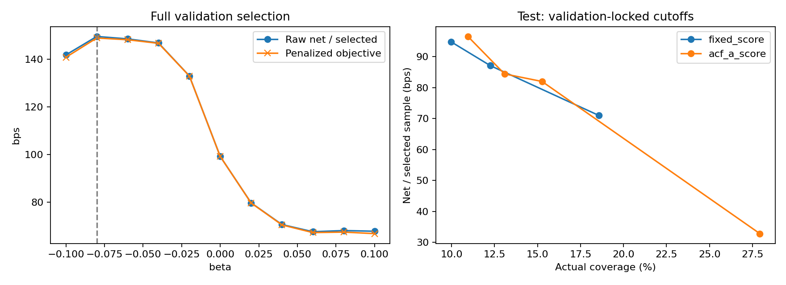

# ACF-A — Shrunk Absolute-ACF Tilt

**Kết quả:** beta=−0,08, fixed tau*=0,64. Trên cùng test cũ, ACF-A có pooled coverage 12,75% (Fixed 12,25%), selective accuracy **69,57%** (68,75%), mean net **91,07** bps/mẫu chọn (87,13) và expected net **11,61** bps/mẫu đủ điều kiện (10,67). Đây là cải thiện pooled tại operating point đã khóa, **chưa chứng minh incremental selection edge độc lập asset allocation**.

Số mẫu test chọn tăng từ 7.984 lên 8.310: BTC giữ 3.808 selections nhưng không nhất thiết cùng mask; ETH tăng 4.176 lên 4.502. Net/mẫu chọn BTC giảm nhẹ −44,29 → −44,41 bps; ETH giảm nhẹ 206,97 → 205,67 bps. Pooled mean net tăng vì tỷ trọng ETH cao hơn, không phải net/mẫu chọn tăng trong từng asset.

Phân rã đại số pooled mean net (file asset_mix_decomposition.json): thay đổi trọng số asset đóng góp **+4,70 bps**, thay đổi mean net trong asset đóng góp **−0,76 bps**, tổng **+3,95 bps**. Tương tự selective accuracy tăng khoảng +0,82 điểm phần trăm: +0,70 do composition và +0,12 do within-asset. Đây là decomposition với reference means Fixed và weights mới, không phải ước lượng nhân quả; không loại trừ sai số thời gian/overlap/oracle filtering.

Validation ACF-A: coverage 18,56%, selective accuracy 76,07%, raw net/mẫu chọn 149,64 bps, expected net 27,77 bps. Objective có penalty tại nghiệm chọn là 149,00 bps. Không chọn beta khác để tối đa expected net sau khi xem test. Runtime khoảng 12,20 giây, peak working set 0,412 GiB; no fallback ở validation/test. Khuyến nghị giữ đây là exploratory result, chưa thay Fixed làm baseline chuẩn hoặc tuyên bố cải thiện giao dịch thực tế.

Giữ nguyên MLP, predictions/calibration, labels/directions, phí 1 bps và toàn bộ cohort baseline: validation 80.260, test 65.182. Không train lại model. Không thêm VR/ER, không thay lag/window hoặc penalty sau kết quả.

## Method và lựa chọn

a=|ACF lag-1 của 360 returns|, finite-sample mean chung như exploratory analysis. h=tanh((a−median_symbol)/IQR_symbol). Median/IQR fit trên full validation, giữ nguyên khi sang test. Threshold=clip(0,64+beta*h,0,50,0,95). Thiếu feature/IQR zero dùng Fixed, không bỏ mẫu.

Grid beta −0,10..+0,10 bước 0,02; maximize mean net/mẫu chọn−100*beta², minimum pooled validation coverage 10%. Không constraint test hoặc từng coin/direction. Fixed tau* dùng grid 0,50..0,94 bước 0,02, maximize raw mean net với cùng validation constraint. Mọi coefficients/normalizers/native/matching cutoffs được khóa trước khi đọc test outcomes. Báo raw net không trừ regularization penalty.

Beta chọn: **-0.08**; fixed tau*: **0.64**.

## Tổng hợp

Coverage/accuracy trong bảng là %. Net/expected net là bps. Primary validation table dùng đủ 80.260 mẫu, không nhầm với temporal subperiods.

| split | method | scope | selected_n | coverage | selective_accuracy | net_selected_bps | expected_net_bps |
|---|---|---|---|---|---|---|---|
| validation | fixed_064 | pooled | 20463 | 25.5 | 68.93 | 99.181 | 25.287 |
| validation | fixed_tau_star | pooled | 20463 | 25.5 | 68.93 | 99.181 | 25.287 |
| validation | acf_a | pooled | 14896 | 18.56 | 76.07 | 149.64 | 27.773 |
| test | fixed_064 | pooled | 7984 | 12.25 | 68.75 | 87.128 | 10.672 |
| test | fixed_tau_star | pooled | 7984 | 12.25 | 68.75 | 87.128 | 10.672 |
| test | acf_a | pooled | 8310 | 12.75 | 69.57 | 91.073 | 11.611 |

## Test theo asset, predicted direction và asset×direction

| split | method | scope | selected_n | coverage | selective_accuracy | net_selected_bps | expected_net_bps |
|---|---|---|---|---|---|---|---|
| test | fixed_064 | BTC_USDT | 3808 | 13.13 | 49.13 | -44.294 | -5.815 |
| test | fixed_064 | ETH_USDT | 4176 | 11.54 | 86.64 | 206.969 | 23.89 |
| test | fixed_064 | predicted_Down | 6505 | 11.19 | 68.73 | 94.786 | 10.609 |
| test | fixed_064 | predicted_Up | 1479 | 20.94 | 68.83 | 53.448 | 11.192 |
| test | fixed_064 | BTC_USDT_predicted_Down | 3470 | 12.47 | 45.99 | -55.958 | -6.977 |
| test | fixed_064 | BTC_USDT_predicted_Up | 338 | 28.84 | 81.36 | 75.461 | 21.763 |
| test | fixed_064 | ETH_USDT_predicted_Down | 3035 | 10.02 | 94.73 | 267.136 | 26.769 |
| test | fixed_064 | ETH_USDT_predicted_Up | 1141 | 19.37 | 65.12 | 46.927 | 9.089 |
| test | fixed_tau_star | BTC_USDT | 3808 | 13.13 | 49.13 | -44.294 | -5.815 |
| test | fixed_tau_star | ETH_USDT | 4176 | 11.54 | 86.64 | 206.969 | 23.89 |
| test | fixed_tau_star | predicted_Down | 6505 | 11.19 | 68.73 | 94.786 | 10.609 |
| test | fixed_tau_star | predicted_Up | 1479 | 20.94 | 68.83 | 53.448 | 11.192 |
| test | fixed_tau_star | BTC_USDT_predicted_Down | 3470 | 12.47 | 45.99 | -55.958 | -6.977 |
| test | fixed_tau_star | BTC_USDT_predicted_Up | 338 | 28.84 | 81.36 | 75.461 | 21.763 |
| test | fixed_tau_star | ETH_USDT_predicted_Down | 3035 | 10.02 | 94.73 | 267.136 | 26.769 |
| test | fixed_tau_star | ETH_USDT_predicted_Up | 1141 | 19.37 | 65.12 | 46.927 | 9.089 |
| test | acf_a | BTC_USDT | 3808 | 13.13 | 49.05 | -44.408 | -5.83 |
| test | acf_a | ETH_USDT | 4502 | 12.44 | 86.92 | 205.67 | 25.594 |
| test | acf_a | predicted_Down | 6555 | 11.28 | 68.94 | 95.552 | 10.777 |
| test | acf_a | predicted_Up | 1755 | 24.85 | 71.91 | 74.344 | 18.473 |
| test | acf_a | BTC_USDT_predicted_Down | 3473 | 12.48 | 45.98 | -56.023 | -6.991 |
| test | acf_a | BTC_USDT_predicted_Up | 335 | 28.58 | 80.9 | 75.998 | 21.723 |
| test | acf_a | ETH_USDT_predicted_Down | 3082 | 10.18 | 94.81 | 266.357 | 27.104 |
| test | acf_a | ETH_USDT_predicted_Up | 1420 | 24.1 | 69.79 | 73.954 | 17.826 |

## Temporal stability trên validation

Prefix 1 chọn beta=0; prefix 2 không có beta thỏa coverage 10% trong quá khứ nên không đánh giá adaptive ở fold đó; prefix 3 chọn beta=−0,08 và cải thiện metrics trên đoạn validation kế tiếp. Vì vậy chưa có sign/feasibility consistency ở cả ba periods. Chỉ báo các trường hợp infeasible, không nới constraint hoặc dùng beta full-validation để lấp fold 2. Beta chính vẫn chọn trên đủ 80.260 validation samples, không đổi theo các diagnostics này.

Đây là secondary diagnostic, không thay main protocol. Ba expanding folds dùng đúng chronological boundaries và purge theo label endpoint 600 dòng như exploratory analysis. Mỗi prefix fit median/IQR và chọn beta chỉ từ prefix. Infeasible thì báo, không nới coverage để cứu; chỉ đánh giá adaptive của fold khi có beta hợp lệ. Có grid và config riêng từng prefix. Không dùng các diagnostics này để đổi beta chính sau khi xem test.

## Coverage-matched

Các điểm target 10% cho actual test coverage Fixed 9,98%, ACF-A 10,95%: khác gần 0,97 điểm phần trăm, chỉ là near coverage; net/mẫu chọn 94,79 và 96,54 bps. Fixed không đạt target 10% trên validation (gần nhất 8,57%) nên không gọi matching hoàn hảo. Target validation 25,50% cho actual test coverage 12,25% và 15,26%, không matched; không so như thể cùng coverage. Các bảng within-asset/direction trong CSV cũng cần đọc actual coverage và counts trước khi kết luận.

coverage_matched_metrics.csv gồm targets 10%,20%,25,50%,40% và pooled/asset/direction/asset×direction scopes. Score fixed=c; score A=c−beta*h. Diagnostic A không clip, khác native rule. Chọn cutoff trên validation score counts sau khi khóa beta; không dùng test quantile/top-k. attainable báo plateau; actual_on_target báo actual drift, không coi target là actual coverage. Không chọn cutoff đẹp trên test làm threshold mới.

## Integrity và giới hạn

Exact ACF/absolute ACF parity so với exploratory cache: PASS; prefix-invariance và direct formula checks trên source prices: PASS. Fixed/tau* pooled và mọi breakdown khớp baseline cũ: PASS. Hash source, model, dữ liệu, proposals và artifacts tham chiếu cũ không đổi. Guard theo stage: peak working set ≤9 GiB, available RAM ≥2 GiB; không phải continuous sampler.

Oracle-filtered cohort |future return|>1%, horizon 600 dòng, overlap/thiếu purge main baseline và reuse validation giữ nguyên. Test đã xem ở các lượt trước: kết quả retrospective/exploratory, không confirmatory OOS. Sample returns/selection counts không phải portfolio PnL hoặc vị thế độc lập. Không triển khai ACF-B trong lượt này.

## Tái lập

Lệnh: `reproduction_setup/venv/Scripts/python.exe research_autocorrelation_threshold/run_acf_a.py`; thêm `--out` đến thư mục mới nếu tái lập, không overwrite. Artifacts gồm đầy đủ beta/fixed grids, locked_config_before_test.json, validation/test_decisions.parquet (probabilities, confidence, labels, signed return, ACF, h, threshold, Long/Short/Abstain), metrics_validation_test.csv, weekly/temporal_stability/macro/coverage_matched/threshold CSVs, prefix configs/grids, completion.json và resources.jsonl.
