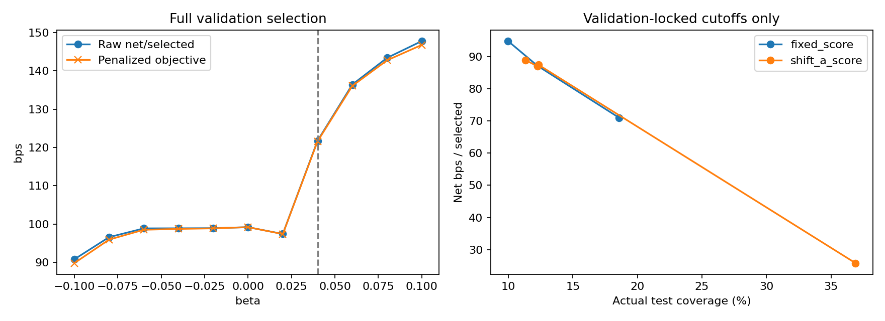

# Shift-A — Shrunk PCA-Residual Threshold

**Kết quả chính:** validation chọn beta=+0,04, tức residual cao làm threshold tăng. Test native: selective accuracy **68,52%** (Fixed 68,75%), mean net/mẫu chọn **88,33 bps** (87,13), expected net/mẫu đủ điều kiện **10,09 bps** (10,67), coverage **11,42%** (12,25%). Chưa thắng Fixed tổng thể; không đổi beta/score/dimension/penalty sau test.

Validation: 8.260 selections, coverage 10,29%, selective accuracy 74,12%, raw mean net 121,78 bps, penalized objective 121,62 bps. Fixed chọn 20.463, coverage 25,50%, accuracy 68,93%, mean net 99,18 bps. Expected net validation của A chỉ 12,53 so với Fixed 25,29 bps vì chọn ít hơn nhiều; đây là trade-off của objective đã chốt, không dùng expected net để chọn lại beta hậu nghiệm. Các beta 0,06/0,08/0,10 có mean net cao hơn nhưng **không đạt minimum coverage validation 10%**, nên bị loại đúng protocol.

Trên test, A chọn 7.442 mẫu so với Fixed 7.984. BTC accuracy 48,49%/net −46,93 bps (Fixed 49,13%/−44,29), ETH 88,45%/+222,95 bps (86,64%/+206,97). A chọn ít ETH hơn (3.730 so với 4.176), và BTC 3.712 so với 3.808. Expected net/mẫu đủ điều kiện giảm ở cả hai coin, dù conditional net ETH tăng.

Phân rã mean net pooled: asset composition đóng góp **−5,49 bps**, within-asset **+6,69 bps**, tổng **+1,21 bps**. Pooled accuracy có composition −0,82 điểm phần trăm và within-asset +0,59, tổng khoảng −0,23. Đây là decomposition theo Fixed means/new weights, không causal attribution. Chưa có kiểm định significance theo time blocks.

Runtime khoảng 7,57 giây, peak working set 0,648 GiB. Cache-recomputed residual max difference **0,0**; spectral/direct projection audit trên 2.048 rows/coin có rank correlation 1,0, max abs difference khoảng 2,35×10⁻¹⁶; orthogonality error khoảng 2,44×10⁻¹⁵. Không fallback ở validation/test. Các checks này chỉ xác minh numeric calculation, không chứng minh residual là economic risk factor.

Giữ MLP, probabilities/labels/directions, phí 1 bps và cohort gốc: validation 80.260, test 65.182. Không train lại network; không fit lại PCA/reference/scaler hoặc chọn dimension theo test.

## Method và selection

Score RMS của spectral components 33..128 trong train-only, per-symbol standardized MLP-feature geometry. PCA32/reference tái sử dụng từ exploratory artifact. h=tanh((score−train_Q50)/(train_Q95−train_Q50)); normalization chỉ từ train, không fit bằng validation/test. Threshold=clip(0,64+beta*h,0,50,0,95). Missing/degenerate train spread override Fixed và giữ mẫu số.

Grid beta −0,10..+0,10 bước 0,02, maximize mean net/mẫu chọn−100*beta², coverage validation pooled>=10%; không constraint test/từng coin/direction. Fixed tau* grid 0,50..0,94 bước 0,02 theo raw mean net với cùng validation constraint. Khóa beta, normalizers, native và matched cutoffs trước khi đọc test. Báo raw return không trừ penalty.

Beta chọn: **0.04**; fixed tau*: **0.64**.

## Metrics tổng hợp

Coverage/accuracy là %, return là bps. Main validation table dùng đủ 80.260 rows, không nhầm với temporal diagnostics.

| split | method | scope | selected_n | coverage | selective_accuracy | net_selected_bps | expected_net_bps |
|---|---|---|---|---|---|---|---|
| validation | fixed_064 | pooled | 20463 | 25.5 | 68.93 | 99.181 | 25.287 |
| validation | fixed_tau_star | pooled | 20463 | 25.5 | 68.93 | 99.181 | 25.287 |
| validation | shift_a | pooled | 8260 | 10.29 | 74.12 | 121.777 | 12.533 |
| test | fixed_064 | pooled | 7984 | 12.25 | 68.75 | 87.128 | 10.672 |
| test | fixed_tau_star | pooled | 7984 | 12.25 | 68.75 | 87.128 | 10.672 |
| test | shift_a | pooled | 7442 | 11.42 | 68.52 | 88.335 | 10.085 |

## Test theo asset, direction và asset×direction

| split | method | scope | selected_n | coverage | selective_accuracy | net_selected_bps | expected_net_bps |
|---|---|---|---|---|---|---|---|
| test | fixed_064 | BTC_USDT | 3808 | 13.13 | 49.13 | -44.294 | -5.815 |
| test | fixed_064 | ETH_USDT | 4176 | 11.54 | 86.64 | 206.969 | 23.89 |
| test | fixed_064 | predicted_Down | 6505 | 11.19 | 68.73 | 94.786 | 10.609 |
| test | fixed_064 | predicted_Up | 1479 | 20.94 | 68.83 | 53.448 | 11.192 |
| test | fixed_064 | BTC_USDT_predicted_Down | 3470 | 12.47 | 45.99 | -55.958 | -6.977 |
| test | fixed_064 | BTC_USDT_predicted_Up | 338 | 28.84 | 81.36 | 75.461 | 21.763 |
| test | fixed_064 | ETH_USDT_predicted_Down | 3035 | 10.02 | 94.73 | 267.136 | 26.769 |
| test | fixed_064 | ETH_USDT_predicted_Up | 1141 | 19.37 | 65.12 | 46.927 | 9.089 |
| test | fixed_tau_star | BTC_USDT | 3808 | 13.13 | 49.13 | -44.294 | -5.815 |
| test | fixed_tau_star | ETH_USDT | 4176 | 11.54 | 86.64 | 206.969 | 23.89 |
| test | fixed_tau_star | predicted_Down | 6505 | 11.19 | 68.73 | 94.786 | 10.609 |
| test | fixed_tau_star | predicted_Up | 1479 | 20.94 | 68.83 | 53.448 | 11.192 |
| test | fixed_tau_star | BTC_USDT_predicted_Down | 3470 | 12.47 | 45.99 | -55.958 | -6.977 |
| test | fixed_tau_star | BTC_USDT_predicted_Up | 338 | 28.84 | 81.36 | 75.461 | 21.763 |
| test | fixed_tau_star | ETH_USDT_predicted_Down | 3035 | 10.02 | 94.73 | 267.136 | 26.769 |
| test | fixed_tau_star | ETH_USDT_predicted_Up | 1141 | 19.37 | 65.12 | 46.927 | 9.089 |
| test | shift_a | BTC_USDT | 3712 | 12.8 | 48.49 | -46.93 | -6.006 |
| test | shift_a | ETH_USDT | 3730 | 10.31 | 88.45 | 222.947 | 22.986 |
| test | shift_a | predicted_Down | 6510 | 11.2 | 68.76 | 94.834 | 10.622 |
| test | shift_a | predicted_Up | 932 | 13.2 | 66.85 | 42.94 | 5.666 |
| test | shift_a | BTC_USDT_predicted_Down | 3470 | 12.47 | 45.99 | -55.958 | -6.977 |
| test | shift_a | BTC_USDT_predicted_Up | 242 | 20.65 | 84.3 | 82.53 | 17.041 |
| test | shift_a | ETH_USDT_predicted_Down | 3040 | 10.04 | 94.74 | 266.955 | 26.795 |
| test | shift_a | ETH_USDT_predicted_Up | 690 | 11.71 | 60.72 | 29.055 | 3.403 |

## Measurement audit và temporal stability

Ở các prefix diagnostics: prefix 1 chọn beta=0, prefix 2 không có beta khả thi với coverage pooled 10%, prefix 3 cũng chọn beta=0. Vì vậy **beta=+0,04 từ full validation chưa được hỗ trợ bởi parameter stability qua các past-prefix periods**. Không nới constraint hoặc dùng beta full validation để lấp fold infeasible. Điều này củng cố việc giữ kết luận exploratory, chưa thay Fixed làm baseline chính.

Recomputed validation spectral residual khớp exploratory cache trong tolerance 1e−14 absolute/1e−12 relative (max delta lưu measurement_audit.json). Kiểm tra orthogonality, spectral tail so với direct projection residual trên 2.048 rows/coin: PASS. Audit này không chứng minh ý nghĩa tài chính hoặc ổn định qua mọi eigensolver/reference precision.

Ba expanding prefix diagnostics trên validation với label-endpoint purge. Geometry/normalization train-only giữ nguyên trong mọi fold, không refit bằng prefix; beta chỉ chọn từ past prefix. Infeasible thì báo và không lấp bằng full-validation beta. Grid từng prefix, prefix_configs.json và validation_temporal_stability.csv giữ đủ; không đổi beta chính theo test.

## Coverage matching và attribution

Diagnostic target validation 20% cho actual test coverage Fixed 12,25% và A 12,26%; mean net 87,13 và 86,97 bps, không cho thấy A tốt hơn ở điểm gần coverage này. Target validation 25,50% cho actual 12,25% và 12,33%, mean net 87,13/87,44 bps, gain rất nhỏ. Fixed không đạt target 20% trên validation do plateau, nên phải đọc cả attainable và actual coverage, không gọi exact matching cả hai tập.

Target 10% cho actual test 9,98%/11,32%, không tương đương theo tolerance 1 điểm phần trăm tại target; không coi mean net ở đó là matched comparison. Không chọn một điểm diagnostic tốt hơn để thay native operating point đã khóa.

Targets 10%,20%,25,50%,40%; cutoffs chọn từ validation score counts, không test quantile/top-k. Fixed score=c, A score=c−beta*h (diagnostic không clip, khác native). Lưu attainable/actual_on_target, actual drift và cả hai coverage kề target. Báo riêng asset/direction và asset×direction; không gọi matched chỉ vì cùng target. asset_mix_decomposition.json tách composition/within-asset effects, không causal.

## Integrity và giới hạn

Baseline Fixed/tau* native khớp kết quả cũ mọi scope: PASS. Cached X_validation và X_test khớp saved matrix manifests, original feature order đối chiếu qua metadata keys. Source/model/reference/train matrices/proposals và inputs cũ được hash trước/sau không đổi. Guard theo stage: peak WS<=9 GiB, available>=2 GiB.

PCA residual nhỏ/low-rank vẫn có thể nhạy tick/precision/subspace; measurement equivalence không chứng minh đây là causal risk score. Oracle filtering |future return|>1%, 600-row labels overlap/thiếu purge main legacy cohort, validation/model calibration reuse và test đã xem giữ nguyên. Kết quả retrospective/exploratory, không confirmatory OOS; sample signals/returns không phải capital-constrained positions/portfolio PnL. Không triển khai Shift-B.

## Tái lập và artifacts

Lệnh: `reproduction_setup/venv/Scripts/python.exe research_distribution_shift_threshold/run_shift_a.py`; dùng `--out` đến thư mục mới nếu tái lập, không overwrite. Có beta/fixed grids, measurement_audit.json, locked_config_before_test.json, metrics_validation_test.csv, weekly/macro/threshold/coverage CSVs, prefix grids/configs/stability CSV, validation/test_decisions.parquet giữ probabilities/confidence/labels/returns/residual/h/threshold/actions, asset_mix_decomposition.json, completion.json, resources.jsonl.
