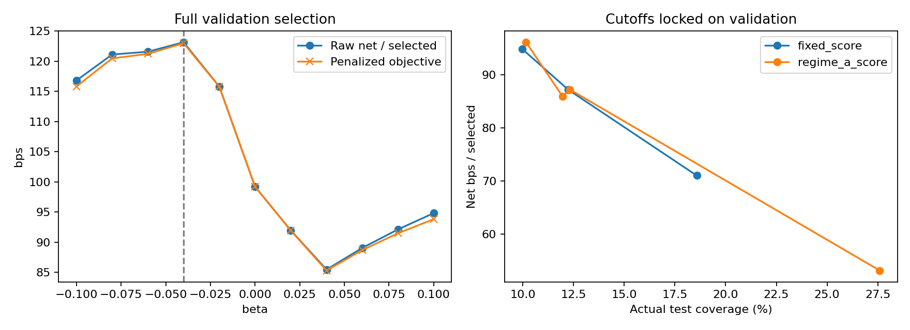

# Regime-A — benchmark trên validation/test BTC/ETH gốc

**Kết quả chính:** validation chọn beta=−0,04. Tại operating point native đã khóa, Regime-A **chưa cải thiện Fixed trên test**: selective accuracy 68,15% so với 68,75%, net/mẫu chọn 86,07 so với 87,13 bps và expected net/mẫu đủ điều kiện 10,26 so với 10,67 bps. Giữ Fixed 0,64 làm baseline; không đổi beta/window/regularization sau khi xem test.

Beta âm nghĩa là hạ threshold khi signed past trend dương và nâng khi trend âm; không phải chỉnh theo độ lớn volatility. Do |z|<1, ngưỡng A nằm xấp xỉ trong (0,60;0,68). Trên validation A đạt selective accuracy 70,71%, net/mẫu chọn 123,14 bps nhưng expected net 24,03 bps thấp hơn Fixed 25,29 bps vì chọn ít mẫu hơn. Objective có penalty ở nghiệm chọn là 122,98 bps, khác raw net báo trong metrics.

Runtime khoảng 10,86 giây, peak working set 0,364 GiB. Validation/test fallback đều bằng 0. Không train lại MLP, không triển khai Regime-B. Các checks về feature equivalence, baseline equivalence và integrity: PASS.

Giữ MLP, probabilities, labels, direction và phí 1 bps; không train lại. Chọn beta trên toàn bộ 80.260 validation samples, minimum coverage pooled 10%; không constraint từng asset/direction hoặc test. Đánh giá trên cùng 65.182 test samples cũ. Không chia nhỏ validation để thay bảng baseline.

## Công thức và lựa chọn

Trend = log(P(t)/P(t−360)) / sqrt(sum của 360 log-returns bình phương); z=tanh(trend/2). Threshold = clip(0,64 + beta*z, 0,50, 0,95). Dùng 360 dòng theo từng symbol, không phải 360 phút cố định; tính từ toàn lịch sử unified, không rolling trên cohort lọc Neutral. Thiếu trend thì dùng fixed. Đã đối chiếu giá trị trend với exploratory artifact tuyệt đối và prefix-invariance trên dữ liệu thật: PASS.

Grid beta −0,10..+0,10 bước 0,02; chọn tối đa mean net bps/mẫu chọn −100*beta², coverage validation pooled ≥10%. Không sweep lại window, scale hoặc penalty. Fixed tau* tối đa raw mean net trên grid 0,50..0,94 bước 0,02 với cùng coverage constraint. Khóa beta, tau*, mọi cutoff matching trước khi đọc test. Không chọn lại theo test.

Beta được chọn: **-0.04**; fixed tau*: **0.64**.

## Kết quả tổng hợp

Coverage/accuracy trong bảng là %. Net và expected net là bps. Objective có penalty chỉ dùng chọn beta; metrics báo return thực không trừ penalty.

| split | method | scope | selected_n | coverage | selective_accuracy | net_selected_bps | expected_net_bps |
|---|---|---|---|---|---|---|---|
| validation | fixed_064 | pooled | 20463 | 25.5 | 68.93 | 99.181 | 25.287 |
| validation | fixed_tau_star | pooled | 20463 | 25.5 | 68.93 | 99.181 | 25.287 |
| validation | regime_a | pooled | 15659 | 19.51 | 70.71 | 123.143 | 24.026 |
| test | fixed_064 | pooled | 7984 | 12.25 | 68.75 | 87.128 | 10.672 |
| test | fixed_tau_star | pooled | 7984 | 12.25 | 68.75 | 87.128 | 10.672 |
| test | regime_a | pooled | 7773 | 11.93 | 68.15 | 86.072 | 10.264 |

## Test theo asset và predicted direction

| split | method | scope | selected_n | coverage | selective_accuracy | net_selected_bps | expected_net_bps |
|---|---|---|---|---|---|---|---|
| test | fixed_064 | BTC_USDT | 3808 | 13.13 | 49.13 | -44.294 | -5.815 |
| test | fixed_064 | ETH_USDT | 4176 | 11.54 | 86.64 | 206.969 | 23.89 |
| test | fixed_064 | predicted_Down | 6505 | 11.19 | 68.73 | 94.786 | 10.609 |
| test | fixed_064 | predicted_Up | 1479 | 20.94 | 68.83 | 53.448 | 11.192 |
| test | fixed_064 | BTC_USDT_predicted_Down | 3470 | 12.47 | 45.99 | -55.958 | -6.977 |
| test | fixed_064 | BTC_USDT_predicted_Up | 338 | 28.84 | 81.36 | 75.461 | 21.763 |
| test | fixed_064 | ETH_USDT_predicted_Down | 3035 | 10.02 | 94.73 | 267.136 | 26.769 |
| test | fixed_064 | ETH_USDT_predicted_Up | 1141 | 19.37 | 65.12 | 46.927 | 9.089 |
| test | fixed_tau_star | BTC_USDT | 3808 | 13.13 | 49.13 | -44.294 | -5.815 |
| test | fixed_tau_star | ETH_USDT | 4176 | 11.54 | 86.64 | 206.969 | 23.89 |
| test | fixed_tau_star | predicted_Down | 6505 | 11.19 | 68.73 | 94.786 | 10.609 |
| test | fixed_tau_star | predicted_Up | 1479 | 20.94 | 68.83 | 53.448 | 11.192 |
| test | fixed_tau_star | BTC_USDT_predicted_Down | 3470 | 12.47 | 45.99 | -55.958 | -6.977 |
| test | fixed_tau_star | BTC_USDT_predicted_Up | 338 | 28.84 | 81.36 | 75.461 | 21.763 |
| test | fixed_tau_star | ETH_USDT_predicted_Down | 3035 | 10.02 | 94.73 | 267.136 | 26.769 |
| test | fixed_tau_star | ETH_USDT_predicted_Up | 1141 | 19.37 | 65.12 | 46.927 | 9.089 |
| test | regime_a | BTC_USDT | 3774 | 13.01 | 48.6 | -46.009 | -5.987 |
| test | regime_a | ETH_USDT | 3999 | 11.05 | 86.6 | 210.722 | 23.293 |
| test | regime_a | predicted_Down | 6513 | 11.21 | 68.72 | 94.784 | 10.622 |
| test | regime_a | predicted_Up | 1260 | 17.84 | 65.16 | 41.042 | 7.322 |
| test | regime_a | BTC_USDT_predicted_Down | 3474 | 12.48 | 45.97 | -56.08 | -7.0 |
| test | regime_a | BTC_USDT_predicted_Up | 300 | 25.6 | 79.0 | 70.625 | 18.078 |
| test | regime_a | ETH_USDT_predicted_Down | 3039 | 10.03 | 94.74 | 267.243 | 26.815 |
| test | regime_a | ETH_USDT_predicted_Up | 960 | 16.3 | 60.83 | 31.798 | 5.182 |

## Coverage và stability

Ở diagnostic target 10%, actual test coverage Fixed 9,98% và A 10,16%; accuracy 68,73% và 69,17%, net/mẫu chọn 94,79 và 96,10 bps. Fixed không đạt target 10% trên validation do plateau (gần nhất 8,57%), nên không gọi đây là matching hoàn hảo. Ở target validation 25,50%, actual test coverage Fixed 12,25% và A 12,32%, net/mẫu chọn 87,13 và 87,17 bps, khác biệt rất nhỏ. Những điểm diagnostic này dùng cutoff đã khóa trên validation, không phải ngưỡng mới được chọn theo test; không chọn một điểm đẹp để thay operating point native hoặc tuyên bố A thắng. Chưa có kiểm định độc lập về incremental value.

coverage_matched_metrics.csv gồm targets 10%, 20%, 25,50%, 40%, pooled, từng asset, từng direction và asset×direction. Score fixed=c, score A=c−beta*z. Diagnostic matching không clip threshold, khác native rule; không refit beta. Cutoff được chọn từ validation score counts, không dùng labels để phá tie và không dùng test quantiles/top-k. attainable=False nếu plateau không cho coverage validation trong ±1 điểm phần trăm; actual_on_target báo coverage thực ở evaluation. Không gọi matched nếu actual coverages chưa tương đương, không coi target là actual coverage.

weekly_metrics.csv giữ mọi tuần có eligible samples, gắn few_samples nếu selections <200. Không chọn tuần tốt để thay beta. fixed_tau_star có thể giống fixed_064; không tạo đối chứng yếu hơn để làm đẹp adaptive.

## Integrity và giới hạn

Baseline native khớp metrics cũ ở validation/test pooled và từng coin: PASS. Hash unified, predictions validation, original model, source tác giả, proposals và các artifacts tham chiếu A/B cũ không đổi. completion.json lưu memory, runtime, cấu hình khóa và hash test predictions. Guard theo stage: 9 GiB peak working set / available RAM tối thiểu 2 GiB. Đây không phải continuous memory sampler.

Cohort đã oracle-filter theo |future return|>1%; horizon 600 dòng chồng lấn, thiếu purge; labels/calibration/threshold reuse được giữ giống baseline. Test đã từng được xem. Tất cả kết quả retrospective/exploratory, không phải confirmatory OOS; sample net returns không phải portfolio PnL hay vị thế độc lập. Không triển khai Regime-B trong lượt này.

## Tái lập và artifacts

Lệnh: `reproduction_setup/venv/Scripts/python.exe research_regime_threshold/run_regime_a.py` (từ chối overwrite; dùng `--out` tới thư mục mới để tái lập). Gồm beta_grid_full_validation.csv, fixed_tau_grid_validation.csv, locked_config_before_test.json, metrics_validation_test.csv, weekly_metrics.csv, coverage_matched_metrics.csv, macro_average_metrics.csv, threshold_distributions.csv, validation/test_decisions.parquet, selection_and_coverage.png, completion.json và resources.jsonl.
