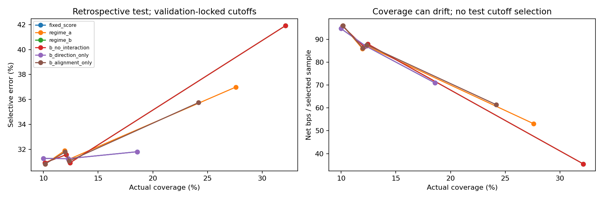

# Regime-B — Direction–Trend Interaction Threshold

**Kết quả chính:** B chọn beta=−0,02, gamma=0, eta=+0,02 trên toàn validation. B **không chọn interaction direction×trend**; nghiệm giống hệt ablation bỏ interaction. Test B tăng selective accuracy và net/mẫu chọn so với Fixed nhưng giảm coverage và expected net/mẫu đủ điều kiện. Chưa có bằng chứng B thắng tổng thể hoặc interaction đem lại incremental value; giữ Fixed làm baseline và không sửa hệ số sau test.

Threshold đã chọn: Up = 0,66 − 0,02*z; Down = 0,62 − 0,02*z (vẫn áp clip 0,50..0,95 trong code). Nghĩa là yêu cầu confidence cao hơn cho Up, thấp hơn cho Down, đồng thời hạ ngưỡng khi trend quá khứ tăng cho cả hai hướng. Đây là kết quả được validation chọn, không phải kết luận tài chính phổ quát.

Giữ MLP, predictions, labels, horizon, phí 1 bps và cohort gốc: validation 80.260, test 65.182 mẫu. Không train lại MLP; không fit logistic correctness mới. Regime-A, Fixed và toàn bộ kết quả cũ giữ nguyên, hash trước/sau kiểm tra PASS.

## Công thức và quy trình

Threshold = clip(0,64 + beta*z + gamma*d*z + eta*d, 0,50, 0,95), z=tanh(trend_360/2), d=+1 khi **MLP dự đoán Up**, −1 khi dự đoán Down; không thay d bằng future label. Tái sử dụng trend đã kiểm chứng tương đương ở Regime-A. Nếu thiếu trend, dùng Fixed.

Grid mỗi hệ số −0,10..+0,10 bước 0,02, tổng |beta|+|gamma|+|eta|≤0,16. Objective validation: mean net/mẫu chọn −100*(beta²+gamma²+eta²), minimum coverage pooled 10%; không yêu cầu từng coin/direction hoặc test đạt 10%. Chọn theo penalized objective, hòa thì ưu tiên norm nhỏ rồi lexicographic; tất cả hệ số, cutoffs matching và ablations được khóa trước lần đọc test outcomes trong script.

Ablations: bỏ interaction gamma=0; direction-only beta=gamma=0; alignment-only beta=eta=0. Chọn từng ablation bằng đúng validation objective, không chọn lại trên test. Fixed tau* và Regime-A dùng tham số cũ. Các return báo trong bảng là raw net sau phí, không trừ regularization penalty.

## Hệ số đã khóa

```json
{
  "models": {
    "regime_b": [
      -0.02,
      0.0,
      0.02
    ],
    "b_no_interaction": [
      -0.02,
      0.0,
      0.02
    ],
    "b_direction_only": [
      0.0,
      0.0,
      0.0
    ],
    "b_alignment_only": [
      0.0,
      -0.04,
      0.0
    ]
  },
  "candidate_counts": {
    "regime_b": {
      "candidates": 719,
      "feasible": 629
    },
    "b_no_interaction": {
      "candidates": 109,
      "feasible": 90
    },
    "b_direction_only": {
      "candidates": 11,
      "feasible": 6
    },
    "b_alignment_only": {
      "candidates": 11,
      "feasible": 11
    }
  }
}
```

## Tổng hợp

Coverage và selective accuracy là %. Net là bps/mẫu. Không gọi accuracy toàn cohort là selective accuracy.

| split | method | scope | selected_n | coverage | selective_accuracy | net_selected_bps | expected_net_bps |
|---|---|---|---|---|---|---|---|
| validation | fixed_064 | pooled | 20463 | 25.5 | 68.93 | 99.181 | 25.287 |
| validation | fixed_tau_star | pooled | 20463 | 25.5 | 68.93 | 99.181 | 25.287 |
| validation | regime_a | pooled | 15659 | 19.51 | 70.71 | 123.143 | 24.026 |
| validation | regime_b | pooled | 8497 | 10.59 | 75.23 | 139.024 | 14.718 |
| validation | b_no_interaction | pooled | 8497 | 10.59 | 75.23 | 139.024 | 14.718 |
| validation | b_direction_only | pooled | 20463 | 25.5 | 68.93 | 99.181 | 25.287 |
| validation | b_alignment_only | pooled | 15691 | 19.55 | 70.66 | 122.946 | 24.036 |
| test | fixed_064 | pooled | 7984 | 12.25 | 68.75 | 87.128 | 10.672 |
| test | fixed_tau_star | pooled | 7984 | 12.25 | 68.75 | 87.128 | 10.672 |
| test | regime_a | pooled | 7773 | 11.93 | 68.15 | 86.072 | 10.264 |
| test | regime_b | pooled | 6627 | 10.17 | 69.19 | 96.173 | 9.778 |
| test | b_no_interaction | pooled | 6627 | 10.17 | 69.19 | 96.173 | 9.778 |
| test | b_direction_only | pooled | 7984 | 12.25 | 68.75 | 87.128 | 10.672 |
| test | b_alignment_only | pooled | 7794 | 11.96 | 68.24 | 86.34 | 10.324 |

## Test theo asset, predicted direction và asset×direction

| split | method | scope | selected_n | coverage | selective_accuracy | net_selected_bps | expected_net_bps |
|---|---|---|---|---|---|---|---|
| test | fixed_064 | BTC_USDT | 3808 | 13.13 | 49.13 | -44.294 | -5.815 |
| test | fixed_064 | ETH_USDT | 4176 | 11.54 | 86.64 | 206.969 | 23.89 |
| test | fixed_064 | predicted_Down | 6505 | 11.19 | 68.73 | 94.786 | 10.609 |
| test | fixed_064 | predicted_Up | 1479 | 20.94 | 68.83 | 53.448 | 11.192 |
| test | fixed_064 | BTC_USDT_predicted_Down | 3470 | 12.47 | 45.99 | -55.958 | -6.977 |
| test | fixed_064 | BTC_USDT_predicted_Up | 338 | 28.84 | 81.36 | 75.461 | 21.763 |
| test | fixed_064 | ETH_USDT_predicted_Down | 3035 | 10.02 | 94.73 | 267.136 | 26.769 |
| test | fixed_064 | ETH_USDT_predicted_Up | 1141 | 19.37 | 65.12 | 46.927 | 9.089 |
| test | fixed_tau_star | BTC_USDT | 3808 | 13.13 | 49.13 | -44.294 | -5.815 |
| test | fixed_tau_star | ETH_USDT | 4176 | 11.54 | 86.64 | 206.969 | 23.89 |
| test | fixed_tau_star | predicted_Down | 6505 | 11.19 | 68.73 | 94.786 | 10.609 |
| test | fixed_tau_star | predicted_Up | 1479 | 20.94 | 68.83 | 53.448 | 11.192 |
| test | fixed_tau_star | BTC_USDT_predicted_Down | 3470 | 12.47 | 45.99 | -55.958 | -6.977 |
| test | fixed_tau_star | BTC_USDT_predicted_Up | 338 | 28.84 | 81.36 | 75.461 | 21.763 |
| test | fixed_tau_star | ETH_USDT_predicted_Down | 3035 | 10.02 | 94.73 | 267.136 | 26.769 |
| test | fixed_tau_star | ETH_USDT_predicted_Up | 1141 | 19.37 | 65.12 | 46.927 | 9.089 |
| test | regime_a | BTC_USDT | 3774 | 13.01 | 48.6 | -46.009 | -5.987 |
| test | regime_a | ETH_USDT | 3999 | 11.05 | 86.6 | 210.722 | 23.293 |
| test | regime_a | predicted_Down | 6513 | 11.21 | 68.72 | 94.784 | 10.622 |
| test | regime_a | predicted_Up | 1260 | 17.84 | 65.16 | 41.042 | 7.322 |
| test | regime_a | BTC_USDT_predicted_Down | 3474 | 12.48 | 45.97 | -56.08 | -7.0 |
| test | regime_a | BTC_USDT_predicted_Up | 300 | 25.6 | 79.0 | 70.625 | 18.078 |
| test | regime_a | ETH_USDT_predicted_Down | 3039 | 10.03 | 94.74 | 267.243 | 26.815 |
| test | regime_a | ETH_USDT_predicted_Up | 960 | 16.3 | 60.83 | 31.798 | 5.182 |
| test | regime_b | BTC_USDT | 3492 | 12.04 | 46.11 | -55.484 | -6.68 |
| test | regime_b | ETH_USDT | 3135 | 8.67 | 94.9 | 265.1 | 22.972 |
| test | regime_b | predicted_Down | 6549 | 11.27 | 68.82 | 95.011 | 10.706 |
| test | regime_b | predicted_Up | 78 | 1.1 | 100.0 | 193.722 | 2.139 |
| test | regime_b | BTC_USDT_predicted_Down | 3481 | 12.51 | 45.94 | -56.114 | -7.018 |
| test | regime_b | BTC_USDT_predicted_Up | 11 | 0.94 | 100.0 | 143.827 | 1.35 |
| test | regime_b | ETH_USDT_predicted_Down | 3068 | 10.13 | 94.78 | 266.48 | 26.994 |
| test | regime_b | ETH_USDT_predicted_Up | 67 | 1.14 | 100.0 | 201.914 | 2.296 |
| test | b_no_interaction | BTC_USDT | 3492 | 12.04 | 46.11 | -55.484 | -6.68 |
| test | b_no_interaction | ETH_USDT | 3135 | 8.67 | 94.9 | 265.1 | 22.972 |
| test | b_no_interaction | predicted_Down | 6549 | 11.27 | 68.82 | 95.011 | 10.706 |
| test | b_no_interaction | predicted_Up | 78 | 1.1 | 100.0 | 193.722 | 2.139 |
| test | b_no_interaction | BTC_USDT_predicted_Down | 3481 | 12.51 | 45.94 | -56.114 | -7.018 |
| test | b_no_interaction | BTC_USDT_predicted_Up | 11 | 0.94 | 100.0 | 143.827 | 1.35 |
| test | b_no_interaction | ETH_USDT_predicted_Down | 3068 | 10.13 | 94.78 | 266.48 | 26.994 |
| test | b_no_interaction | ETH_USDT_predicted_Up | 67 | 1.14 | 100.0 | 201.914 | 2.296 |
| test | b_direction_only | BTC_USDT | 3808 | 13.13 | 49.13 | -44.294 | -5.815 |
| test | b_direction_only | ETH_USDT | 4176 | 11.54 | 86.64 | 206.969 | 23.89 |
| test | b_direction_only | predicted_Down | 6505 | 11.19 | 68.73 | 94.786 | 10.609 |
| test | b_direction_only | predicted_Up | 1479 | 20.94 | 68.83 | 53.448 | 11.192 |
| test | b_direction_only | BTC_USDT_predicted_Down | 3470 | 12.47 | 45.99 | -55.958 | -6.977 |
| test | b_direction_only | BTC_USDT_predicted_Up | 338 | 28.84 | 81.36 | 75.461 | 21.763 |
| test | b_direction_only | ETH_USDT_predicted_Down | 3035 | 10.02 | 94.73 | 267.136 | 26.769 |
| test | b_direction_only | ETH_USDT_predicted_Up | 1141 | 19.37 | 65.12 | 46.927 | 9.089 |
| test | b_alignment_only | BTC_USDT | 3773 | 13.01 | 48.61 | -45.921 | -5.974 |
| test | b_alignment_only | ETH_USDT | 4021 | 11.11 | 86.67 | 210.443 | 23.39 |
| test | b_alignment_only | predicted_Down | 6534 | 11.24 | 68.84 | 95.075 | 10.689 |
| test | b_alignment_only | predicted_Up | 1260 | 17.84 | 65.16 | 41.042 | 7.322 |
| test | b_alignment_only | BTC_USDT_predicted_Down | 3473 | 12.48 | 45.98 | -55.988 | -6.986 |
| test | b_alignment_only | BTC_USDT_predicted_Up | 300 | 25.6 | 79.0 | 70.625 | 18.078 |
| test | b_alignment_only | ETH_USDT_predicted_Down | 3061 | 10.11 | 94.77 | 266.471 | 26.931 |
| test | b_alignment_only | ETH_USDT_predicted_Up | 960 | 16.3 | 60.83 | 31.798 | 5.182 |

## Coverage-matched và stability

### Diễn giải native operating points

- Validation B: 8.497 selections, coverage 10,59%, accuracy 75,23%, net/mẫu chọn 139,02 bps. Fixed 20.463 selections, 25,50%, 68,93%, 99,18 bps. B chọn ít mẫu hơn rất nhiều; expected net B 14,72 bps thấp hơn Fixed 25,29 bps. Objective đã chốt là mean net/mẫu chọn có penalty, không phải expected net/mẫu đủ điều kiện.
- Test B: 6.627 selections, coverage 10,17%, accuracy 69,19%, net/mẫu chọn 96,17 bps; Fixed 7.984 selections, 12,25%, 68,75%, 87,13 bps. Expected net B **9,78** bps so với Fixed **10,67**; không diễn giải tăng net/mẫu chọn là tăng lợi nhuận toàn bộ cơ hội.
- Test Regime-A: coverage 11,93%, accuracy 68,15%, net/mẫu chọn 86,07 bps và expected net 10,26 bps. B tốt hơn A về accuracy/net mẫu chọn nhưng thấp hơn về expected net.
- Test BTC B: accuracy 46,11%, net −55,48 bps/mẫu chọn, thấp hơn Fixed 49,13%/−44,29 bps. Test ETH B: accuracy 94,90%, net +265,10 bps/mẫu chọn, cao hơn Fixed 86,64%/+206,97 bps. Không lấy ETH để che mất kết quả BTC.
- Ablation bỏ interaction trùng toàn bộ kết quả B, xác nhận gamma=0. Direction-only chọn eta=0, tức trở về Fixed; alignment-only chọn gamma=−0,04 nhưng test net/mẫu chọn 86,34 bps, expected net 10,32 bps, không vượt Fixed. Không chọn lại ablation tốt nhất bằng test.

### Diễn giải diagnostic cùng/near coverage

Target validation 10% cho actual test coverage Fixed 9,98%, A 10,16%, B 10,13%; net/mẫu chọn tương ứng 94,79, 96,10, 95,88 bps. B không cho thấy lợi thế rõ hơn A tại coverage gần nhau. Fixed thực tế không đạt 10% trên validation vì plateau (gần nhất 8,57%), nên không gọi matching hoàn hảo ở cả hai tập.

Target validation 25,50% cho actual test coverage Fixed 12,25%, A 12,32%, B 12,44%; net/mẫu chọn 87,13, 87,17, 88,01 bps. Chênh lệch nhỏ, chưa kiểm định statistical significance; không thay native cutoff bằng điểm diagnostic đẹp hơn. Các target khác có coverage drift, phải đọc cả actual coverage trong CSV.

### Tài nguyên và kiểm chứng

Đã chấm 719 tổ hợp thỏa budget hệ số, 629 tổ hợp thỏa coverage pooled validation. Ablation gamma=0 có 109 tổ hợp/90 coverage-feasible; direction-only 11/6; alignment-only 11/11. Grid của A lồng trong B khớp tuyệt đối tới tolerance đã công bố với lần chạy trước. Runtime khoảng 8,59 giây, peak working set 0,210 GiB; source và toàn bộ artifacts A cũ không đổi.

coverage_matched_metrics.csv có targets 10%, 20%, 25,50%, 40%; scope pooled, mỗi asset, mỗi direction và asset×direction. Score là confidence trừ adjustment, diagnostic không clip (khác native). Khóa hệ số rồi chọn cutoff bằng validation score counts, không dùng return/label để phá tie. Không dùng test quantile/top-k để ép coverage. attainable và hai coverage kề target báo plateau; actual_on_target báo actual drift. Không coi hai phương pháp matched chỉ vì target cùng nhau. weekly_metrics.csv giữ mọi tuần có mẫu, few_samples đánh dấu selections <200.



## Integrity, giới hạn và tái lập

Nested grid gamma=eta=0 được đối chiếu với Regime-A cũ, raw và penalized metrics tương đương: PASS. Native Fixed/tau*/A đối chiếu nguyên kết quả cũ: PASS. Không chỉnh params sau bảng test. Toàn bộ kết quả retrospective/exploratory: test đã xem trước; validation dùng lại cho calibration/model selection/thresholds; oracle filter loại |future return|≤1%; horizon 600 dòng overlap, không purge thêm để giữ cohort baseline. Sample returns không phải portfolio PnL, không báo annualized Sharpe hoặc IID significance.

Lệnh: `reproduction_setup/venv/Scripts/python.exe research_regime_threshold/run_regime_b.py`; dùng `--out` cho thư mục mới nếu tái lập, không overwrite. Có parameter grid đầy đủ, locked_config_before_test.json, metrics_validation_test.csv, coverage_matched_metrics.csv, weekly_metrics.csv, macro_average_metrics.csv, threshold_distributions.csv, validation/test_decisions.parquet, previous_artifact_sha256.json, completion.json, resources.jsonl. Guard kiểm tra theo stage: peak working set ≤9 GiB, available RAM ≥2 GiB.
